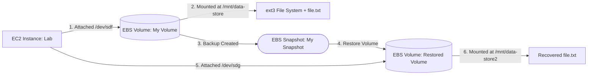

# 💾 Amazon EBS Block Storage Management, Persistence & Snapshot Recovery


A hands-on cloud storage and Linux systems administration project on AWS demonstrating the complete lifecycle of **Amazon Elastic Block Store (Amazon EBS)** volumes. This project covers provisioning and attaching a General Purpose SSD (`gp2`) volume to an **Amazon EC2** instance, formatting an `ext3` file system, configuring persistent mounts via `/etc/fstab`, creating point-in-time **EBS Snapshots**, simulating accidental file deletion, and performing disaster recovery by restoring a new volume from the snapshot.

---

## 📌 Project Overview & Objectives

Amazon EBS provides persistent, block-level storage volumes for use with Amazon EC2 instances within the same Availability Zone. This project demonstrates how to expand compute storage capacity, ensure file system persistence across instance reboots, and protect critical data against accidental loss using incremental point-in-time snapshots backed by Amazon S3.

**Primary Objectives:**
* Provision a `1 GiB` **General Purpose SSD (`gp2`)** Amazon EBS volume (`My Volume`) in the same Availability Zone (`us-west-2a`) as the target **Amazon EC2** instance (`Lab`).
* Attach the EBS volume to the EC2 instance (`/dev/sdf`), format it with an **`ext3` file system**, and mount it at `/mnt/data-store`.
* Configure `/etc/fstab` with `defaults,noatime` options so the volume automatically remounts across system reboots.
* Create a point-in-time **Amazon EBS Snapshot (`My Snapshot`)** and simulate accidental data loss by deleting `/mnt/data-store/file.txt`.
* Recover the lost data by provisioning a new EBS volume (`Restored Volume`) from the snapshot, attaching it as `/dev/sdg`, mounting it at `/mnt/data-store2`, and verifying file integrity.

---

## ✨ Key Features

* **AZ-Aligned Block Storage Provisioning:** Deploys SSD-backed (`gp2`) block storage matched to the target EC2 instance's Availability Zone (`us-west-2a`).
* **Persistent Linux File System Configuration:** Formats raw block devices with `mkfs -t ext3` and persists mount definitions in `/etc/fstab`.
* **Point-in-Time Snapshot Backup:** Captures used storage blocks from the active volume into an Amazon EBS Snapshot (`My Snapshot`) stored durably in Amazon S3.
* **Rapid Volume Cloning & Disaster Recovery:** Restores a point-in-time snapshot into a brand-new independent EBS volume (`Restored Volume`) and mounts it side-by-side to recover deleted files without downtime on the primary volume.

---

## 🏗️ Architecture & Storage Lifecycle Workflow

```text
+-------------------------------------------------------------------------------+
| AWS Cloud (Availability Zone: us-west-2a)                                     |
|                                                                               |
|  [ 🖥️ Amazon EC2 Instance: Lab ]                                              |
|    ├── Root Volume: /dev/xvda1 (8 GiB) ──► Mounted on /                       |
|    │                                                                          |
|    ├── 1. Attached: [ 💾 EBS Volume: My Volume (1 GiB gp2) ]                  |
|    │        Device: /dev/sdf (/dev/xvdf) ──► Mounted on /mnt/data-store       |
|    │        └── Created file.txt  ──► (Simulated deletion: rm file.txt)       |
|    │                  │                                                       |
|    │                  │ 2. Point-in-Time Backup (Prior to deletion)           |
|    │                  ▼                                                       |
|    │        [ 📸 EBS Snapshot: My Snapshot ] (Stored durably in Amazon S3)    |
|    │                  │                                                       |
|    │                  │ 3. Restore New Volume from Snapshot                   |
|    │                  ▼                                                       |
|    └── 4. Attached: [ 💾 EBS Volume: Restored Volume (1 GiB gp2) ]            |
|             Device: /dev/sdg ──► Mounted on /mnt/data-store2                  |
|             └── Verified recovered file.txt!                                  |
+-------------------------------------------------------------------------------+
```



### Step-by-Step Workflow
1. **Volume Provisioning & Attachment:** A `1 GiB` `gp2` EBS volume (`My Volume`) is created in `us-west-2a` and attached to the `Lab` EC2 instance as `/dev/sdf` (mapped by the Linux kernel to `/dev/xvdf`).
2. **Formatting & Persistent Mounting:** On the EC2 instance, the block device is formatted with an `ext3` file system, mounted to `/mnt/data-store`, and registered in `/etc/fstab`. A test file (`file.txt`) is written to the mounted volume.
3. **Snapshot Creation:** An EBS Snapshot (`My Snapshot`) of `My Volume` is created, copying the used blocks to Amazon S3.
4. **Data Loss Simulation:** The file `/mnt/data-store/file.txt` is permanently deleted from `My Volume` using `rm`.
5. **Snapshot Restoration & Verification:** A new EBS volume (`Restored Volume`) is created from `My Snapshot` in `us-west-2a`, attached to the `Lab` instance as `/dev/sdg`, and mounted at `/mnt/data-store2`, restoring immediate access to `file.txt`.

---

## 🛠️ AWS Services & Linux Tools Used

| Service / Tool | Role in Project |
| :--- | :--- |
| **Amazon EBS (Volumes)** | Provides persistent `1 GiB` General Purpose SSD (`gp2`) block storage volumes (`My Volume` and `Restored Volume`). |
| **Amazon EBS (Snapshots)** | Captures point-in-time block-level backups (`My Snapshot`) stored redundantly in Amazon S3. |
| **Amazon EC2 (`Lab`)** | Hosts the Linux compute instance in `us-west-2a` where the EBS volumes are attached and mounted. |
| **EC2 Instance Connect** | Provides browser-based SSH terminal access to the `Lab` EC2 instance. |
| **Linux Storage Utilities (`df`, `mkfs`, `mount`, `/etc/fstab`)** | Inspects disk space, formats `ext3` file systems, mounts block devices, and persists mount tables across reboots. |

---

## ⚙️ Step-by-Step Implementation

### 1. Provisioning & Attaching the Primary EBS Volume (`My Volume`)
* Verified the Availability Zone of the running `Lab` EC2 instance (`us-west-2a`).
* Created a new Amazon EBS volume with the following parameters:
  * **Volume Type:** `General Purpose SSD (gp2)`
  * **Size:** `1 GiB`
  * **Availability Zone:** `us-west-2a`
  * **Tag:** `Name = My Volume`
* Attached `My Volume` to the `Lab` instance using device name `/dev/sdf`.

### 2. Formatting, Mounting & Persisting the File System on Linux
Connected to the `Lab` instance via **EC2 Instance Connect** and configured the storage volume:

```bash
# 1. Inspect initial mounted filesystems (shows only the 8 GiB root volume /dev/xvda1)
df -h

# 2. Format the attached volume (/dev/sdf) with an ext3 filesystem
sudo mkfs -t ext3 /dev/sdf

# 3. Create the mount point directory and mount the volume
sudo mkdir /mnt/data-store
sudo mount /dev/sdf /mnt/data-store

# 4. Append the mount entry to /etc/fstab for persistence across reboots
echo "/dev/sdf   /mnt/data-store ext3 defaults,noatime 1 2" | sudo tee -a /etc/fstab

# 5. Verify the /etc/fstab configuration and confirm the mounted volume
cat /etc/fstab
df -h
```

**Verified `df -h` Output After Mounting:**
```text
Filesystem      Size  Used Avail Use% Mounted on
devtmpfs        488M   60K  488M   1% /dev
tmpfs           497M     0  497M   0% /dev/shm
/dev/xvda1      7.8G  982M  6.7G  13% /
/dev/xvdf       976M  1.3M  924M   1% /mnt/data-store
```

### 3. Writing Test Data & Creating an EBS Snapshot
Created a test file inside `/mnt/data-store` and verified its contents:

```bash
sudo sh -c "echo some text has been written > /mnt/data-store/file.txt"
cat /mnt/data-store/file.txt
```

* In the **EC2 Console → Volumes**, selected `My Volume` and created a snapshot tagged `Name = My Snapshot`.

### 4. Simulating Data Loss & Restoring from Snapshot
Deleted `file.txt` from the original volume and verified its removal:

```bash
sudo rm /mnt/data-store/file.txt
ls /mnt/data-store/file.txt
# Output: ls: cannot access /mnt/data-store/file.txt: No such file or directory
```

* Selected `My Snapshot` in the **Snapshots** console and chose **Create volume from snapshot** in `us-west-2a`, tagged `Name = Restored Volume`.
* Attached `Restored Volume` to the `Lab` EC2 instance as `/dev/sdg`.
* Mounted the restored volume to `/mnt/data-store2` and verified data recovery:

```bash
sudo mkdir /mnt/data-store2
sudo mount /dev/sdg /mnt/data-store2
ls /mnt/data-store2/file.txt
```

---

## 🧪 Testing & Validation

| Test Phase | Action Performed | Observed Result |
| :--- | :--- | :--- |
| **1. Initial Mount & Persistence** | Formatted `/dev/sdf` as `ext3`, mounted on `/mnt/data-store`, and updated `/etc/fstab`. | `df -h` displayed `/dev/xvdf` (`976M` size, `924M` available) mounted at `/mnt/data-store`. |
| **2. Data Write Verification** | Wrote string to `/mnt/data-store/file.txt` and ran `cat`. | Terminal returned `some text has been written`. |
| **3. Accidental Deletion Simulation** | Executed `sudo rm /mnt/data-store/file.txt` after taking `My Snapshot`. | `ls /mnt/data-store/file.txt` confirmed the file no longer existed on the primary volume. |
| **4. Snapshot Volume Recovery** | Attached `Restored Volume` (`/dev/sdg`), mounted on `/mnt/data-store2`, and ran `ls /mnt/data-store2/file.txt`. | `file.txt` was present and intact inside `/mnt/data-store2`. |

---

## 📸 Implementation Screenshots

Complete visual evidence of the EBS volume creation, Linux mounting, snapshot backup, deletion simulation, and volume restoration is available in the [**screenshots/**](./screenshots/) directory:

1. [EBS Volume Created and Attached to EC2 Instance](./screenshots/SCREENSHOTS.md#1-ebs-volume-created-and-attached-to-ec2-instance)
2. [Disk Formatted and Mounted on Linux (`/mnt/data-store`)](./screenshots/SCREENSHOTS.md#2-disk-formatted-and-mounted-on-linux-mntdata-store)
3. [Amazon EBS Snapshot Created (`My Snapshot`)](./screenshots/SCREENSHOTS.md#3-amazon-ebs-snapshot-created-my-snapshot)
4. [Simulated Data Loss: Test File Deleted](./screenshots/SCREENSHOTS.md#4-simulated-data-loss--test-file-deleted)
5. [Restored Volume Created from EBS Snapshot](./screenshots/SCREENSHOTS.md#5-restored-volume-created-from-ebs-snapshot)
6. [Restored Volume Mounted and Recovered File Verified](./screenshots/SCREENSHOTS.md#6-restored-volume-mounted-and-recovered-file-verified)

---

## 🔒 Security Considerations & Potential Improvements

### Implemented Practices
* **Point-in-Time Recovery:** Created an EBS Snapshot prior to destructive file operations, enabling full recovery onto an isolated mount point (`/mnt/data-store2`).
* **Mount Optimization:** Applied the `noatime` mount option in `/etc/fstab` to avoid unnecessary disk write operations every time a file is read.

### Potential Future Enhancements (Not Currently Implemented)
* **Upgrade to `gp3` & Modern File Systems (`xfs` / `ext4`):** Migrate from `gp2` to `gp3` volumes for 20% lower baseline cost and independent IOPS/throughput scaling, and format new volumes with `xfs` or `ext4` instead of legacy `ext3`.
* **UUID-Based `/etc/fstab` Entries with `nofail`:** Reference block devices by `UUID=...` (via `blkid`) instead of device names (`/dev/sdf`) and add the `nofail` option in `/etc/fstab` so the EC2 instance can still boot if an additional volume is detached.
* **Amazon Data Lifecycle Manager (DLM):** Automate daily snapshot creation, retention policies, and cross-region snapshot copy for disaster recovery.
* **EBS Encryption at Rest:** Enable AWS KMS encryption on EBS volumes and snapshots to protect data at rest.

---

## 🎯 Key Technical Skills Demonstrated

* **Cloud Block Storage Management:** Provisioning, tagging, attaching, snapshotting, and restoring Amazon EBS volumes across EC2 instances.
* **Linux Storage Administration:** Formatting block devices (`mkfs`), managing mount points (`mount`), inspecting disk usage (`df -h`), and configuring boot persistence (`/etc/fstab`).
* **Backup & Disaster Recovery:** Executing point-in-time recovery workflows from Amazon EBS Snapshots to restore deleted application data.
