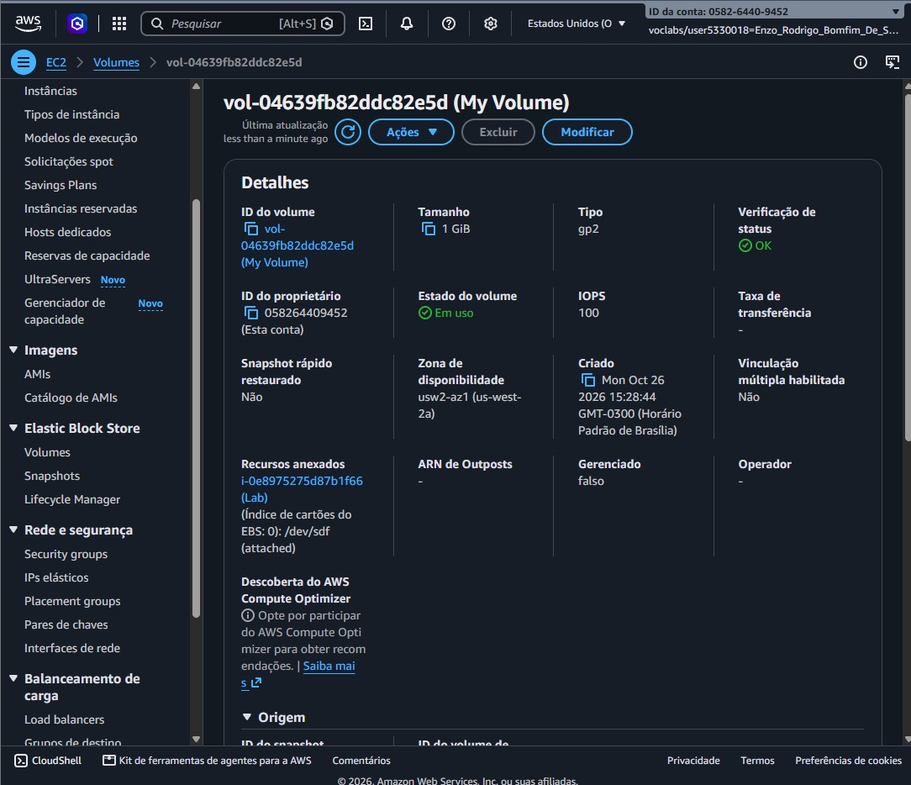
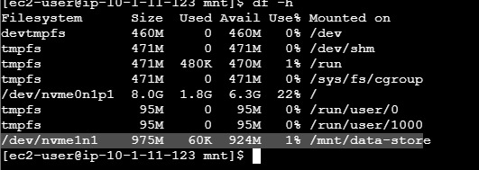
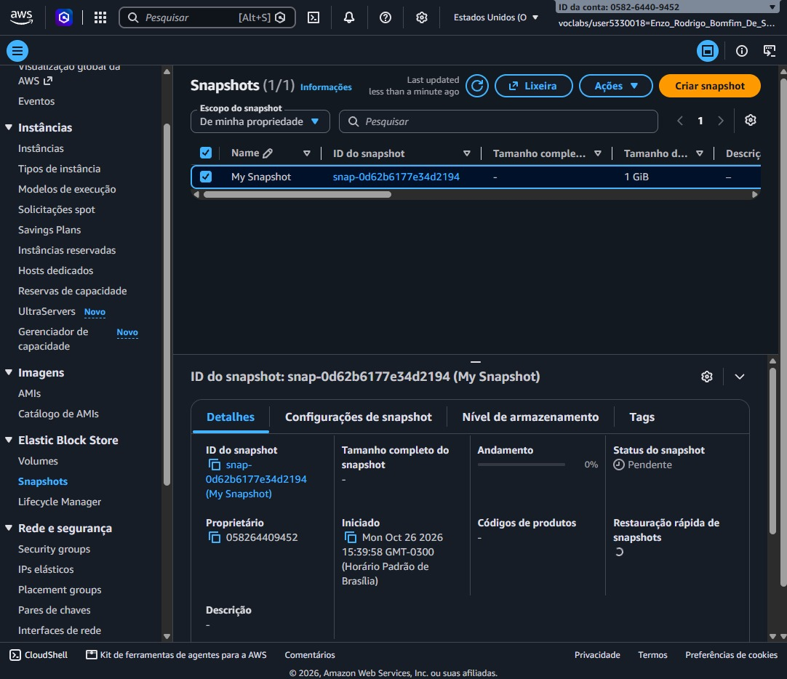
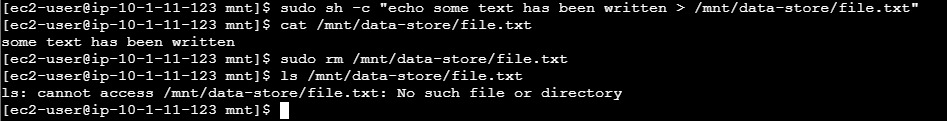
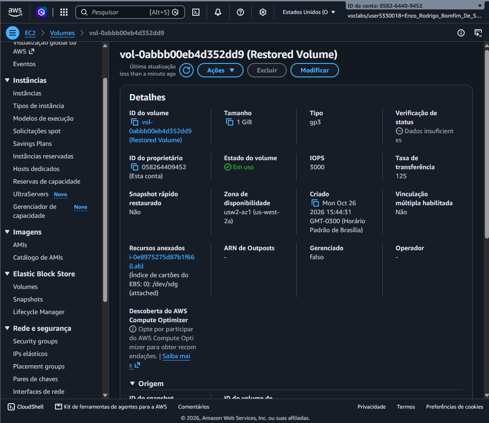
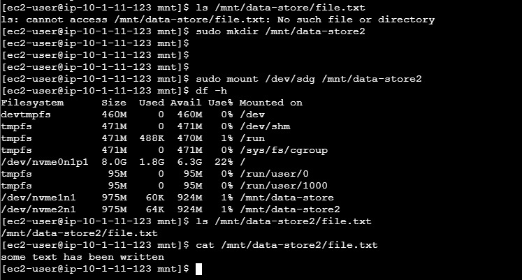

# 📸 Project Implementation & Validation Screenshots

This document provides step-by-step visual evidence of the EBS volume provisioning, Linux file system mounting, snapshot creation, data loss simulation, and volume restoration for the **Amazon EBS Block Storage Management, Persistence & Snapshot Recovery** project.

---

## 1. EBS Volume Created and Attached to EC2 Instance

Provisioning of the `1 GiB` General Purpose SSD (`gp2`) Amazon EBS volume (`My Volume`) in `us-west-2a` and attachment to the `Lab` EC2 instance as `/dev/sdf`.

---

## 2. Disk Formatted and Mounted on Linux (`/mnt/data-store`)

Formatting `/dev/sdf` (`/dev/xvdf`) with an `ext3` file system, mounting it to `/mnt/data-store`, configuring `/etc/fstab` persistence, and verifying available storage with `df -h`.

---

## 3. Amazon EBS Snapshot Created (`My Snapshot`)

Creation and completion of the point-in-time Amazon EBS Snapshot (`My Snapshot`) taken from `My Volume` after writing the test file.

---

## 4. Simulated Data Loss — Test File Deleted

Removal of `/mnt/data-store/file.txt` using `sudo rm` and verification via `ls` that the file no longer exists on the primary volume.

---

## 5. Restored Volume Created from EBS Snapshot

Provisioning of the new `Restored Volume` in `us-west-2a` created directly from `My Snapshot` and attached to the `Lab` EC2 instance as `/dev/sdg`.

---

## 6. Restored Volume Mounted and Recovered File Verified

Mounting `Restored Volume` (`/dev/sdg`) at `/mnt/data-store2` and verifying that `/mnt/data-store2/file.txt` and its contents were successfully recovered from the snapshot.

