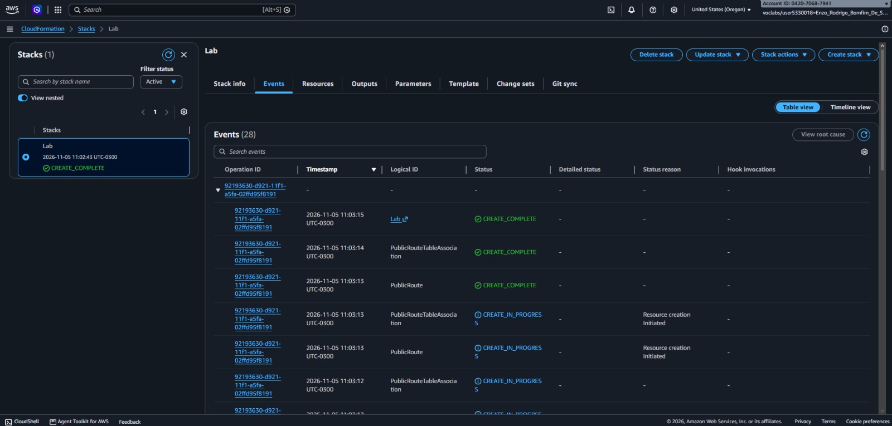
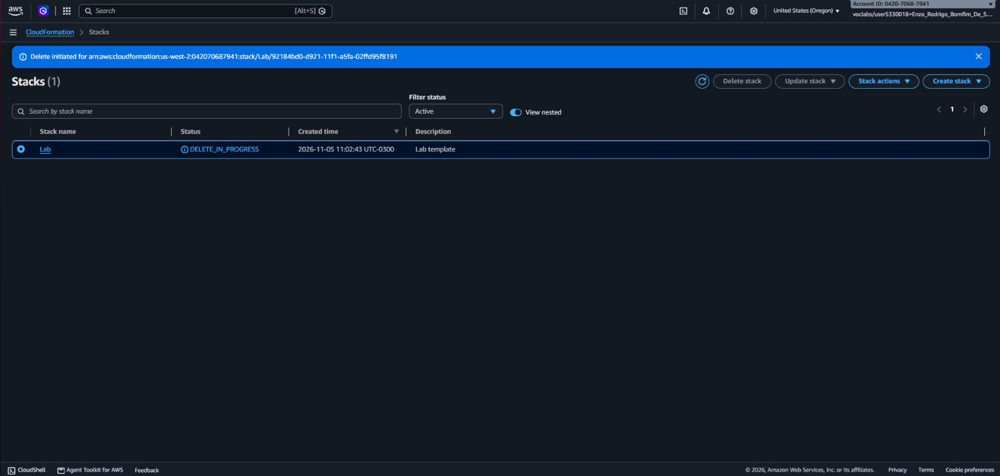
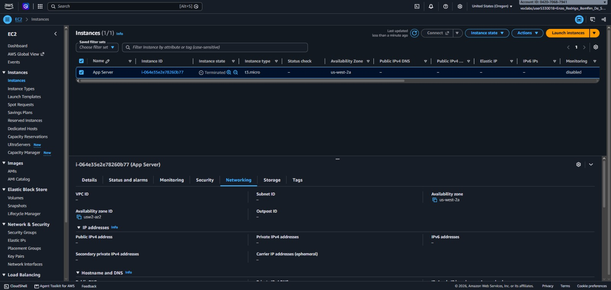

# 📸 Project Implementation & Verification Screenshots

### 1. CloudFormation Initial VPC Stack Deployment

Creation of the `Lab` stack in AWS CloudFormation using the declarative YAML template to automatically provision the custom VPC (`10.0.0.0/16`), public subnet, Internet Gateway, route table, and security group.

Defining network topologies as code ensures repeatable, error-free deployments and allows CloudFormation to automatically resolve resource creation dependencies.

### 2. Automated Resource Cleanup via Stack Deletion

Execution of the CloudFormation stack deletion process (`DELETE_IN_PROGRESS`), automatically deprovisioning all resources created and managed by the `Lab` stack.

Tearing down environments at the stack level guarantees that all associated infrastructure components are removed in the proper dependency order without leaving orphaned resources behind.

### 3. EC2 App Server Termination Verification

Verification in the Amazon EC2 console confirming that the `App Server` (`t3.micro`) instance provisioned via the YAML template has transitioned to the `Terminated` state following stack deletion.

Confirming compute instance termination validates that CloudFormation lifecycle management cleanly releases billable EC2 capacity upon stack removal.

