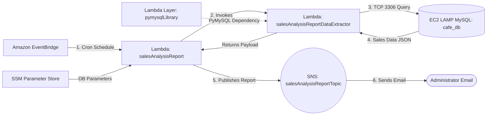

# 📊 AWS Serverless Automated Sales Analysis Report


A multi-function serverless reporting pipeline built on AWS using **AWS Lambda**, **Lambda Layers (`PyMySQL`)**, **Amazon EventBridge (CloudWatch Events)**, **AWS Systems Manager (SSM) Parameter Store**, **Amazon SNS**, and **Amazon VPC**. The solution automatically extracts daily sales data from a **MySQL (`cafe_db`)** database hosted on an **Amazon EC2 (LAMP)** instance and dispatches formatted analytical reports via email on a recurring Cron schedule.

---

## 📌 Project Overview & Objectives

This hands-on cloud engineering project demonstrates how to deploy, network, troubleshoot, and orchestrate a decoupled two-tier serverless reporting system that securely queries a relational database inside a Virtual Private Cloud (VPC).

**Primary Objectives:**
* Configure **IAM Execution Roles** with least-privilege policies for Lambda-to-Lambda invocation, VPC network interface management, SSM Parameter Store retrieval, and SNS publishing.
* Create and attach a custom **AWS Lambda Layer (`pymysqlLibrary`)** to supply external Python library dependencies (`PyMySQL`).
* Configure **Lambda VPC networking** (VPC, Subnet, and Security Group) and troubleshoot database connectivity timeouts using **Amazon CloudWatch Logs** and **VPC Security Group rules**.
* Deploy an orchestrator Lambda function (`salesAnalysisReport`) via the **AWS CLI** and configure runtime **Environment Variables**.
* Automate daily report execution using an **Amazon EventBridge (CloudWatch Events)** Cron schedule and deliver email notifications via **Amazon SNS**.

---

## ✨ Key Features

* **Decoupled Two-Function Lambda Pattern:** Separates workflow orchestration (`salesAnalysisReport`) from VPC-bound database extraction (`salesAnalysisReportDataExtractor`).
* **Reusable Dependency Management:** Packages the third-party `PyMySQL` driver into a versioned **AWS Lambda Layer** (`pymysqlLibrary`) so function deployment packages remain lightweight.
* **Centralized Configuration Management:** Retrieves database connection parameters (`/cafe/dbUrl`, `/cafe/dbName`, `/cafe/dbUser`, `/cafe/dbPassword`) dynamically from **AWS Systems Manager Parameter Store** and injects the target SNS Topic ARN via **Lambda Environment Variables** (`topicARN`).
* **VPC-Integrated Database Access:** Connects the data extractor Lambda function directly to the private/public Cafe VPC networking layer over TCP port `3306`.
* **Scheduled Cron Automation:** Executes unattended daily sales reports from Monday to Saturday using **Amazon EventBridge**.

---

## 🏗️ Architecture & Automated Workflow

```text
[⏰ Amazon EventBridge]
   │  (1. Cron Trigger: Mon-Sat 20:00 UTC)
   ▼
[⚡ Lambda: salesAnalysisReport] ◄─── (Reads DB Config) ─── [🔧 SSM Parameter Store]
   │  │                                                      (/cafe/dbUrl, dbName,
   │  │ (2. Invokes with DB params)                           dbUser, dbPassword)
   │  ▼
   │  [⚡ Lambda: salesAnalysisReportDataExtractor] + [📦 Layer: pymysqlLibrary]
   │     │
   │     │ (3. Queries MySQL over TCP 3306 inside Cafe VPC)
   │     ▼
   │  [🗄️ Amazon EC2 LAMP (MySQL: cafe_db)]
   │     │
   │     └──► (4. Returns aggregated order records JSON)
   │
   ├──► (5. Formats report & publishes to topicARN)
   ▼
[📢 Amazon SNS: salesAnalysisReportTopic]
   │
   └──► (6. Sends Daily Sales Analysis Report Email) ──► [📧 Administrator Inbox]
```



### Step-by-Step Workflow
1. **Scheduled Trigger:** An **Amazon EventBridge (CloudWatch Events)** rule (`salesAnalysisReportDailyTrigger`) invokes the `salesAnalysisReport` Lambda function according to a Cron schedule (configured for `20:00 UTC`, Monday through Saturday).
2. **Parameter Retrieval & Invocation:** The `salesAnalysisReport` function reads the database connection parameters (`/cafe/dbUrl`, `/cafe/dbName`, `/cafe/dbUser`, `/cafe/dbPassword`) from **AWS Systems Manager Parameter Store** and invokes the `salesAnalysisReportDataExtractor` Lambda function.
3. **Database Query Execution:** Running inside the `Cafe VPC` with the `pymysqlLibrary` layer attached, `salesAnalysisReportDataExtractor` connects to the `cafe_db` MySQL database on the `CafeInstance` EC2 server over TCP port `3306` and runs an analytical query aggregating product sales.
4. **Data Return:** The extracted sales dataset is returned as a JSON payload to `salesAnalysisReport`.
5. **Report Formatting & Publishing:** `salesAnalysisReport` formats the query output into a structured summary message and publishes it to the **Amazon SNS** topic `salesAnalysisReportTopic` (referenced via the `topicARN` environment variable).
6. **Email Delivery:** Amazon SNS delivers the formatted **Daily Sales Analysis Report** email to the confirmed administrator email address.

---

## 🛠️ AWS Services & Responsibilities

| AWS Service | Role in Architecture |
| :--- | :--- |
| **AWS Lambda** | Runs the `salesAnalysisReport` orchestrator function and the `salesAnalysisReportDataExtractor` database query function on Python 3.9. |
| **AWS Lambda Layers** | Hosts the `pymysqlLibrary` (Version 1) archive (`pymysql-v3.zip`), providing the `PyMySQL` library to the extractor function. |
| **Amazon EventBridge (CloudWatch Events)** | Triggers `salesAnalysisReport` automatically via the `salesAnalysisReportDailyTrigger` Cron schedule rule. |
| **AWS Systems Manager (Parameter Store)** | Stores the cafe database configuration parameters (`/cafe/dbUrl`, `/cafe/dbName`, `/cafe/dbUser`, `/cafe/dbPassword`). |
| **Amazon SNS** | Manages the `salesAnalysisReportTopic` (`SARTopic`) standard topic and delivers daily sales report emails to subscribers. |
| **Amazon EC2 (LAMP Stack & CLI Host)** | `CafeInstance` hosts the PHP/Apache web store and `cafe_db` MySQL database; `CLI Host` provides the environment for AWS CLI deployment. |
| **Amazon VPC & Security Groups** | Provides network isolation and traffic control (`Cafe VPC`, `Cafe Public Subnet 1`, and `CafeSecurityGroup`) between Lambda and EC2. |
| **AWS IAM** | Enforces service permissions through `salesAnalysisReportRole` and `salesAnalysisReportDERole`. |
| **Amazon CloudWatch Logs** | Captures execution logs (`START`, `END`, `REPORT`) and timeout stack traces used during troubleshooting. |

---

## 🔐 IAM Roles & Permissions

| IAM Role | Assigned Function | Attached Policies & Responsibilities |
| :--- | :--- | :--- |
| **`salesAnalysisReportRole`** | `salesAnalysisReport` | • `AmazonSNSFullAccess`: Publishes formatted reports to SNS.<br>• `AmazonSSMReadOnlyAccess`: Reads `/cafe/*` database parameters from SSM Parameter Store.<br>• `AWSLambdaBasicRunRole`: Writes execution logs to CloudWatch Logs.<br>• `AWSLambdaRole`: Invokes the `salesAnalysisReportDataExtractor` function. |
| **`salesAnalysisReportDERole`** | `salesAnalysisReportDataExtractor` | • `AWSLambdaBasicRunRole`: Writes execution logs to CloudWatch Logs.<br>• `AWSLambdaVPCAccessRunRole`: Creates and manages Elastic Network Interfaces (ENIs) to connect Lambda to the Cafe VPC. |

---

## ⚙️ Implementation & Deployment Overview

### 1. Lambda Layer & Data Extractor Function (`salesAnalysisReportDataExtractor`)
* **Layer Creation:** Created `pymysqlLibrary` (Version 1) using `pymysql-v3.zip` for the **Python 3.9** runtime.
* **Function Provisioning:** Created `salesAnalysisReportDataExtractor` (`Python 3.9`) with the `salesAnalysisReportDERole` execution role, attached `pymysqlLibrary` (Version 1), uploaded `salesAnalysisReportDataExtractor-v3.zip`, and set the handler to:
  ```text
  salesAnalysisReportDataExtractor.lambda_handler
  ```
* **VPC Networking:** Attached the function to `Cafe VPC`, `Cafe Public Subnet 1`, and `CafeSecurityGroup` so it could reach the private/internal MySQL instance.

### 2. Orchestrator Function Deployment via AWS CLI (`salesAnalysisReport`)
Connected to the **CLI Host** EC2 instance via **EC2 Instance Connect**, configured the AWS CLI (`aws configure` for region `us-west-2` and `json` output), and deployed `salesAnalysisReport` from `/activity-files/salesAnalysisReport-v2.zip`:

```bash
aws lambda create-function \
  --function-name salesAnalysisReport \
  --runtime python3.9 \
  --zip-file fileb://salesAnalysisReport-v2.zip \
  --handler salesAnalysisReport.lambda_handler \
  --region us-west-2 \
  --role <salesAnalysisReportRoleARN>
```

* **Environment Variable Configuration:** Added the `topicARN` environment variable to `salesAnalysisReport` pointing to the ARN of `salesAnalysisReportTopic`.

### 3. Scheduled Automation (`salesAnalysisReportDailyTrigger`)
Configured an **Amazon EventBridge (CloudWatch Events)** rule named `salesAnalysisReportDailyTrigger` (`Initiates report generation on a daily basis`):
* **Test Schedule Expression:** Configured a Cron expression set 5 minutes ahead in UTC (`cron(Minutes Hours ? * MON-SAT *)`) to validate automated invocation.
* **Production Target Schedule (8:00 PM UTC, Mon–Sat):**
  ```text
  cron(0 20 ? * MON-SAT *)
  ```

---

## 🧪 Testing, Troubleshooting & Validation

### Phase 1 — Initial Extractor Test & Timeout Troubleshooting
Tested `salesAnalysisReportDataExtractor` with the `SARDETestEvent` payload containing the SSM Parameter Store values:

```json
{
  "dbUrl": "<value of /cafe/dbUrl parameter>",
  "dbName": "<value of /cafe/dbName parameter>",
  "dbUser": "<value of /cafe/dbUser parameter>",
  "dbPassword": "<value of /cafe/dbPassword parameter>"
}
```

* **Observed Issue:** Execution failed after 3 seconds with a timeout error in CloudWatch Logs:
  ```json
  {
    "errorMessage": "Task timed out after 3.00 seconds"
  }
  ```
* **Root Cause Diagnosis:** The Lambda function attempted to establish a TCP connection to the MySQL server on port `3306`, but `CafeSecurityGroup` did not have an inbound rule permitting MySQL traffic on port `3306`.
* **Resolution:** Added an inbound rule to `CafeSecurityGroup` allowing TCP port `3306`.
* **Verification (Empty Database):** Re-running `SARDETestEvent` succeeded immediately with HTTP `200` and an empty list prior to customer orders:
  ```json
  {
    "statusCode": 200,
    "body": []
  }
  ```

### Phase 2 — Populating Cafe Orders & Validating Data Extraction
Accessed the Cafe web application (`http://<CafePublicIP>/cafe`), placed product orders through the online menu, and re-invoked `salesAnalysisReportDataExtractor` using `SARDETestEvent`. The function returned the aggregated sales records from `cafe_db`:

```json
{
  "statusCode": 200,
  "body": [
    {
      "product_group_number": 1,
      "product_group_name": "Pastries",
      "product_id": 1,
      "product_name": "Croissant",
      "quantity": 1
    },
    {
      "product_group_number": 2,
      "product_group_name": "Drinks",
      "product_id": 8,
      "product_name": "Hot Chocolate",
      "quantity": 2
    }
  ]
}
```

### Phase 3 — End-to-End Orchestration & Scheduled Email Delivery
1. **Manual Invocation (`SARTestEvent`):** Invoked `salesAnalysisReport` in the Lambda console, returning:
   ```json
   {
     "statusCode": 200,
     "body": "\"Sale Analysis Report sent.\""
   }
   ```
2. **Automated Scheduled Trigger:** Waited for the `salesAnalysisReportDailyTrigger` EventBridge Cron rule to fire and confirmed automatic delivery of the **Daily Sales Analysis Report** email via Amazon SNS.

---

## 📸 Implementation Screenshots

Complete visual evidence of the provisioning, network troubleshooting, CLI deployment, and automated email delivery is available in the [**screenshots/**](./screenshots/) directory:

1. [Lambda Layer Creation (`pymysqlLibrary`)](./screenshots/SCREENSHOTS.md#1-lambda-layer-creation)
2. [Data Extractor Function Creation and Layer Attachment](./screenshots/SCREENSHOTS.md#2-data-extractor-function-creation-and-layer-attachment)
3. [Lambda VPC Network Configuration](./screenshots/SCREENSHOTS.md#3-lambda-vpc-network-configuration)
4. [Test 1: Initial Execution Timeout Error (3 Seconds)](./screenshots/SCREENSHOTS.md#4-test-1--initial-execution-timeout-error)
5. [Security Group Fix: Allowing MySQL Port 3306](./screenshots/SCREENSHOTS.md#5-security-group-fix--allowing-mysql-port-3306)
6. [Test 2: Successful Database Connection after Security Group Fix](./screenshots/SCREENSHOTS.md#6-test-2--successful-database-connection)
7. [Generating Sales Data on the Cafe Web Application](./screenshots/SCREENSHOTS.md#7-generating-sales-data-on-the-cafe-web-application)
8. [Test 3: Successful Sales Data Extraction JSON Response](./screenshots/SCREENSHOTS.md#8-test-3--successful-sales-data-extraction-json-response)
9. [Amazon SNS Topic and Email Subscription Configuration](./screenshots/SCREENSHOTS.md#9-amazon-sns-topic-and-email-subscription-configuration)
10. [Creating the `salesAnalysisReport` Function via AWS CLI](./screenshots/SCREENSHOTS.md#10-creating-the-salesanalysisreport-function-via-aws-cli)
11. [Configuring the `topicARN` Environment Variable](./screenshots/SCREENSHOTS.md#11-configuring-the-topicarn-environment-variable)
12. [Adding the Scheduled EventBridge Cron Trigger](./screenshots/SCREENSHOTS.md#12-adding-the-scheduled-eventbridge-cron-trigger)
13. [Automated Daily Sales Analysis Report Email Received](./screenshots/SCREENSHOTS.md#13-automated-daily-sales-analysis-report-email-received)

---

## 🔒 Security Considerations & Potential Improvements

### Implemented Practices
* **Externalized Database Credentials:** Database connection parameters are stored in **AWS Systems Manager Parameter Store** (`/cafe/*`) rather than hardcoded in the orchestrator source code.
* **Environment-Based Topic Configuration:** The SNS Topic ARN is injected via the `topicARN` environment variable instead of modifying application code.
* **Role Separation:** Distinct IAM roles (`salesAnalysisReportRole` and `salesAnalysisReportDERole`) isolate permissions between the orchestrator and the VPC data extractor.

### Potential Future Enhancements (Not Currently Implemented)
* **AWS Secrets Manager & SecureString Rotation:** Store `/cafe/dbPassword` in AWS Secrets Manager with automatic credential rotation instead of standard plaintext parameters.
* **Scoped IAM Policies:** Narrow `AmazonSNSFullAccess` on `salesAnalysisReportRole` to allow `sns:Publish` exclusively on the `salesAnalysisReportTopic` ARN.
* **Multi-AZ Private Subnets & RDS Proxy:** Deploy the database in private subnets across multiple Availability Zones and use Amazon RDS Proxy to manage database connection pooling from AWS Lambda.

---

## 🎯 Key Technical Skills Demonstrated

* **Serverless Compute & Modular Packaging:** Building multi-function AWS Lambda workflows and packaging third-party Python dependencies (`PyMySQL`) using Lambda Layers.
* **Cloud Networking & Troubleshooting:** Configuring Lambda VPC access, diagnosing connection timeouts via CloudWatch Logs, and remediating Security Group inbound rules (`TCP 3306`).
* **AWS CLI & SysOps Automation:** Deploying Lambda functions from `.zip` artifacts via the AWS CLI on Amazon EC2 and scheduling recurring jobs with Amazon EventBridge Cron expressions.
* **Service Integration:** Orchestrating AWS Systems Manager Parameter Store, AWS IAM, AWS Lambda, Amazon EC2 (MySQL), and Amazon SNS.
