# 📸 Project Implementation & Validation Screenshots

This document provides step-by-step visual evidence of the provisioning, VPC network troubleshooting, AWS CLI deployment, and scheduled end-to-end validation of the **AWS Serverless Automated Sales Analysis Report** solution.

---

## 1. Lambda Layer Creation

Creation of the custom `pymysqlLibrary` (Version 1) AWS Lambda Layer using `pymysql-v3.zip` for the Python 3.9 runtime to provide the `PyMySQL` client dependency.

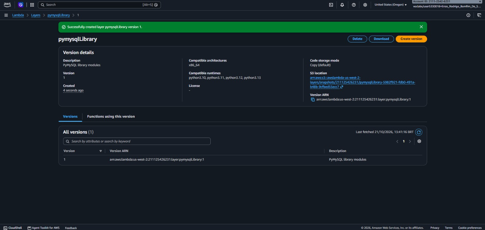

---

## 2. Data Extractor Function Creation and Layer Attachment

Provisioning of the `salesAnalysisReportDataExtractor` Lambda function (`Python 3.9`, execution role `salesAnalysisReportDERole`) and attachment of the `pymysqlLibrary` custom layer.

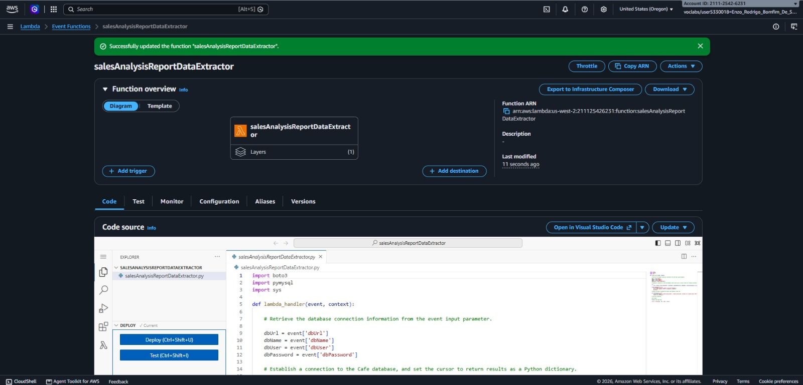

---

## 3. Lambda VPC Network Configuration

Configuration of the `salesAnalysisReportDataExtractor` function networking settings to connect to `Cafe VPC`, `Cafe Public Subnet 1`, and `CafeSecurityGroup`.

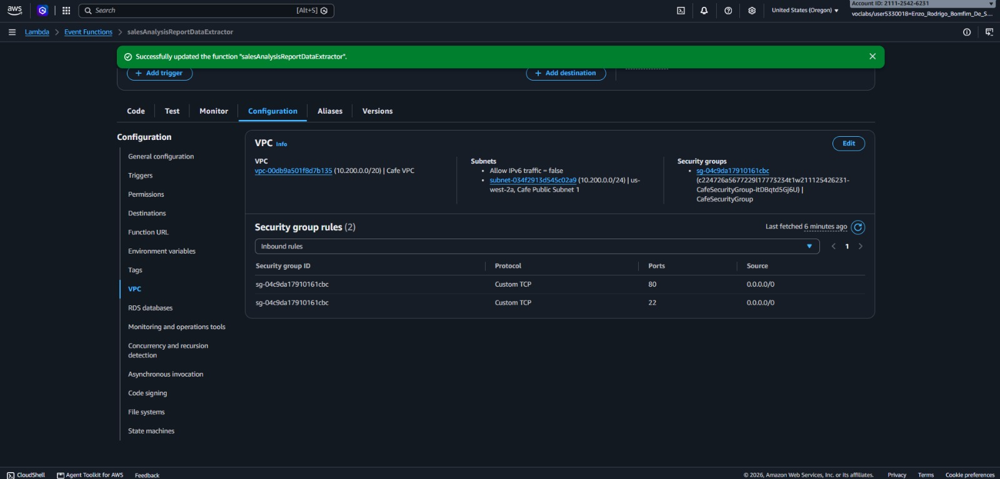

---

## 4. Test 1 — Initial Execution Timeout Error

Initial test execution (`SARDETestEvent`) failing after 3.00 seconds (`Task timed out after 3.00 seconds`) due to blocked network connectivity to the MySQL instance.

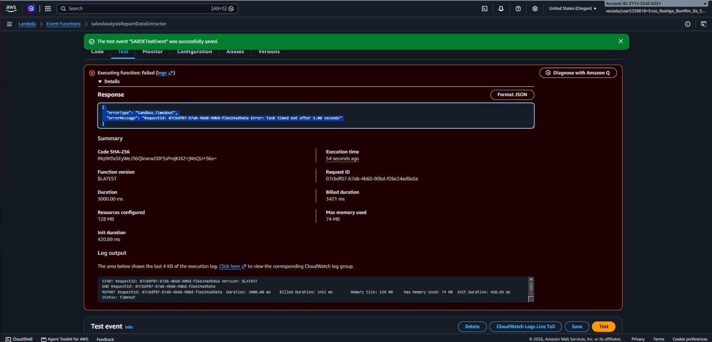

---

## 5. Security Group Fix — Allowing MySQL Port 3306

Remediation of the timeout issue by adding an inbound rule to `CafeSecurityGroup` allowing TCP traffic on port `3306` to reach the MySQL database (`cafe_db`).

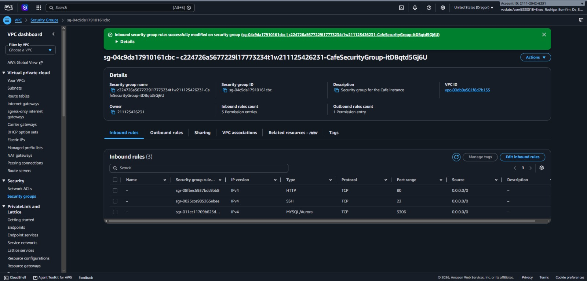

---

## 6. Test 2 — Successful Database Connection

Re-execution of `SARDETestEvent` after updating the security group rule, resulting in a successful execution (`statusCode: 200`) with an empty array prior to placing orders.

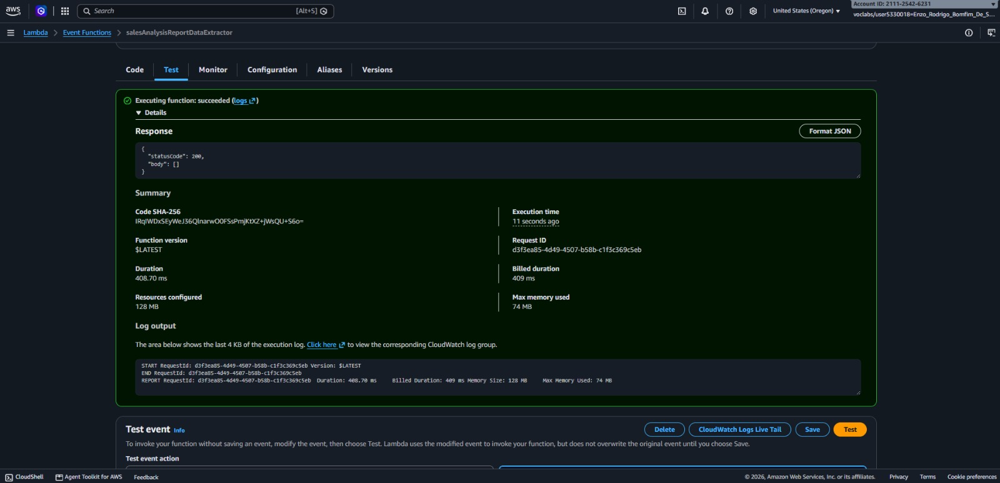

---

## 7. Generating Sales Data on the Cafe Web Application

Placing customer orders on the Cafe web store (`http://<CafePublicIP>/cafe`) hosted on the EC2 LAMP instance to populate the `cafe_db` MySQL database.

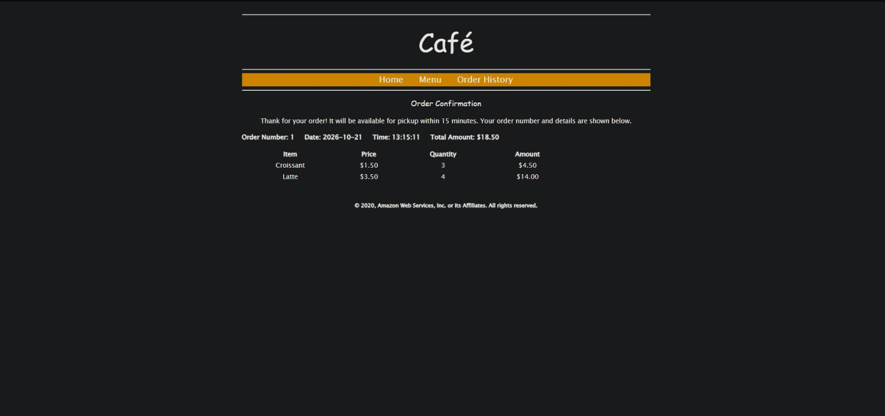

---

## 8. Test 3 — Successful Sales Data Extraction JSON Response

Validation test of `salesAnalysisReportDataExtractor` returning the JSON array of ordered cafe products and quantities queried from `cafe_db`.

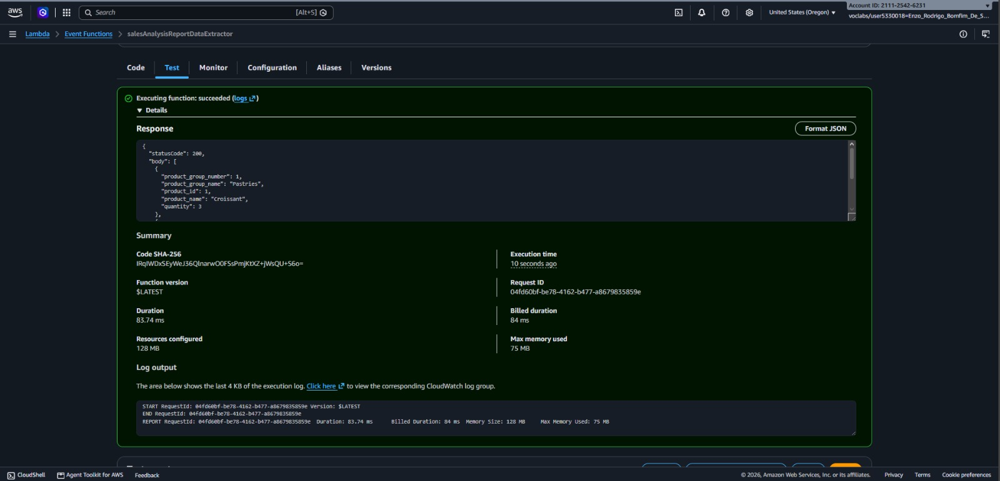

---

## 9. Amazon SNS Topic and Email Subscription Configuration

Creation of the `salesAnalysisReportTopic` (`SARTopic`) standard Amazon SNS topic and confirmation of the administrator email subscription.

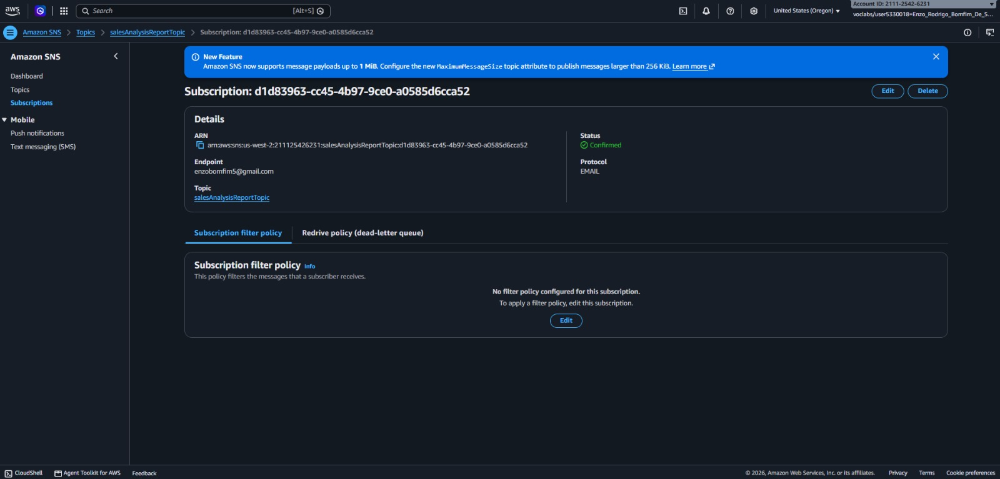

---

## 10. Creating the `salesAnalysisReport` Function via AWS CLI

Deployment of the `salesAnalysisReport` orchestrator Lambda function (`python3.9`) from the `CLI Host` EC2 instance using the `aws lambda create-function` command.

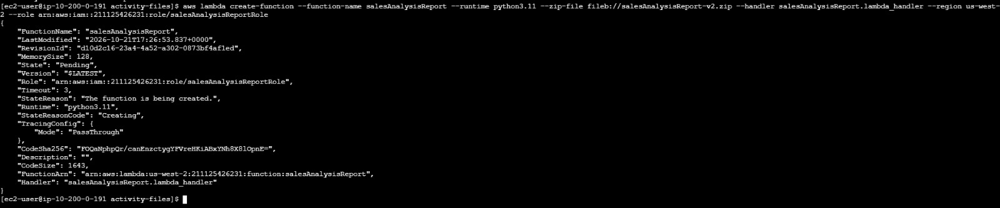

---

## 11. Configuring the `topicARN` Environment Variable

Configuration of the `topicARN` environment variable on the `salesAnalysisReport` Lambda function with the ARN of `salesAnalysisReportTopic`.

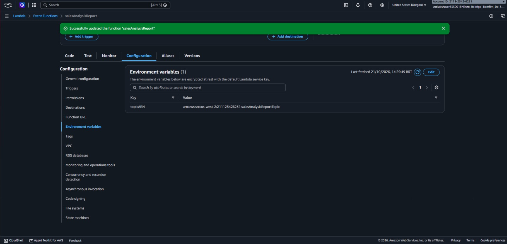

---

## 12. Adding the Scheduled EventBridge Cron Trigger

Configuration of the `salesAnalysisReportDailyTrigger` scheduled rule in Amazon EventBridge (CloudWatch Events) using a Cron expression to automate report generation.

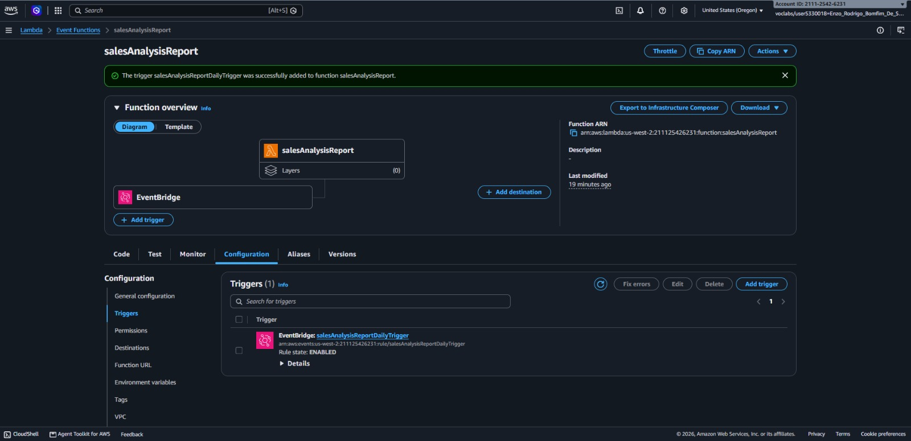

---

## 13. Automated Daily Sales Analysis Report Email Received

Confirmation of the formatted Daily Sales Analysis Report email automatically generated and delivered via Amazon SNS following the scheduled EventBridge invocation.

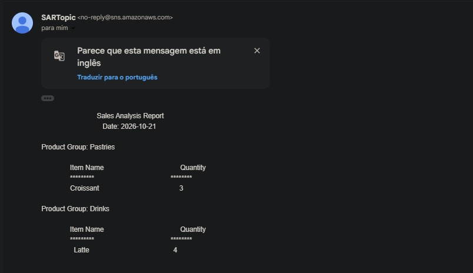
