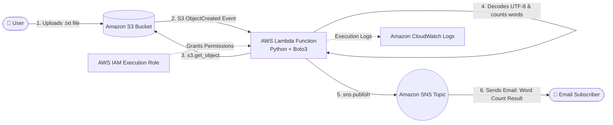

# ☁️ AWS Serverless Word Count Automation with S3, Lambda, and SNS


An event-driven, serverless file-processing pipeline built on AWS using **Python (Boto3)**, **Amazon S3**, **AWS Lambda**, and **Amazon SNS**. Whenever a `.txt` file is uploaded to an S3 bucket, an automated workflow retrieves the object, calculates the total word count, and dispatches a formatted email notification to subscribed endpoints.

---

## 📌 Project Overview & Objectives

This hands-on cloud engineering project demonstrates how to design and implement a decoupled, event-driven serverless architecture on AWS without provisioning or managing servers.

**Primary Objectives:**
* Configure **Amazon S3 event notifications** to automatically trigger compute workflows upon object creation.
* Develop a **Python AWS Lambda function** using the **Boto3 SDK** to extract event metadata, read S3 object streams, and process text data.
* Integrate **Amazon Simple Notification Service (SNS)** to broadcast formatted processing results via email.
* Configure **AWS Identity and Access Management (IAM)** permissions and monitor execution logs through **Amazon CloudWatch**.

---

## ✨ Key Features

* **Zero-Server Automation:** Fully serverless execution triggered automatically by S3 object uploads.
* **URL-Safe Object Key Parsing:** Handles spaces and special UTF-8 characters in uploaded filenames using `urllib.parse.unquote_plus`.
* **In-Memory Text Processing:** Reads and decodes UTF-8 file streams directly from S3 and calculates word counts across spaces and line breaks.
* **Instant Email Alerts:** Publishes standardized summary notifications to subscribers via Amazon SNS.
* **Execution Observability:** Logs execution payloads and confirmation statuses to Amazon CloudWatch Logs.

---

## 🏗️ Architecture & Event-Driven Workflow



### Step-by-Step Workflow
1. **File Upload:** A user uploads a `.txt` file to the target **Amazon S3** bucket.
2. **Event Trigger:** The S3 bucket's event notification detects the object creation and asynchronously invokes the **AWS Lambda** function, passing an event payload in JSON format.
3. **Object Retrieval:** The Lambda function extracts the bucket name and URL-decoded object key from the event payload and fetches the file from S3 using `s3.get_object()`.
4. **Word Count Calculation:** The Python runtime reads the file stream, decodes the content using `utf-8`, and splits the text by whitespace and line breaks using Python's `split()` method to count the total words.
5. **Message Formatting:** Lambda constructs the notification string and sets the required email subject.
6. **Notification Publishing:** Lambda calls `sns.publish()` to send the message to the configured **Amazon SNS** topic.
7. **Subscriber Delivery:** Amazon SNS delivers the email with the subject `Word Count Result` and the calculated word count to the confirmed email subscriber.

---

## 🛠️ AWS Services Used

| AWS Service | Role in Architecture |
| :--- | :--- |
| **Amazon S3** | Provides durable object storage for uploaded `.txt` files and generates event notifications that trigger the serverless pipeline. |
| **AWS Lambda** | Executes the serverless Python word-count logic on demand in response to S3 upload events. |
| **Amazon SNS** | Acts as the pub/sub messaging bus that formats and delivers email notifications to subscribed recipients. |
| **AWS IAM** | Grants the Lambda execution role permissions to read objects from S3, publish messages to SNS, and write logs to CloudWatch. |
| **Amazon CloudWatch** | Captures function output (`print` statements) and execution metrics for verification and troubleshooting. |

---

## 🐍 Python Implementation Overview

### Source Code (`lambda_function.py`)

```python
import json
import urllib.parse
import boto3

# Initializes the S3 and SNS clients
s3 = boto3.client('s3')
sns = boto3.client('sns')

# IMPORTANT: Replace the value below with the ARN of your SNS topic copied in Step 2
SNS_TOPIC_ARN = 'PASTE_YOUR_SNS_TOPIC_ARN_HERE'

def lambda_handler(event, context):
    # 1. Extracts the bucket name and file name (key) from the event sent by S3
    bucket = event['Records'][0]['s3']['bucket']['name']
    key = urllib.parse.unquote_plus(event['Records'][0]['s3']['object']['key'], encoding='utf-8')
    
    # 2. Reads the text file stored in S3
    response = s3.get_object(Bucket=bucket, Key=key)
    content = response['Body'].read().decode('utf-8')
    
    # 3. Splits the text by spaces/line breaks and counts the total number of words
    words = content.split()
    count = len(words)
    
    # 4. Formats the message and subject exactly as required by the challenge
    message = f"The word count in the {key} file is {count}."
    subject = "Word Count Result"
    
    # 5. Sends the notification to the Amazon SNS topic
    sns.publish(
        TopicArn=SNS_TOPIC_ARN,
        Message=message,
        Subject=subject
    )
    
    print(f"Success: {message}")
    
    return {
        'statusCode': 200,
        'body': json.dumps(message)
    }
```

### Code Breakdown
* **SDK & Service Clients (`boto3`):** `boto3` is the official AWS SDK for Python. Initializing `boto3.client('s3')` and `boto3.client('sns')` outside `lambda_handler` allows the execution environment to reuse client connections across invocations.
* **Configuration Placeholder (`SNS_TOPIC_ARN`):** The `SNS_TOPIC_ARN` constant is set to `'PASTE_YOUR_SNS_TOPIC_ARN_HERE'` to avoid exposing AWS account IDs in version control. It must be replaced with the actual SNS Topic ARN before deploying the function.
* **Lambda Entry Point (`lambda_handler`):** Receives the S3 `event` dictionary and runtime `context`.
* **Event Extraction & URL Decoding:**
  * `event['Records'][0]['s3']['bucket']['name']` retrieves the source S3 bucket name.
  * `event['Records'][0]['s3']['object']['key']` retrieves the uploaded filename (object key).
  * `urllib.parse.unquote_plus(..., encoding='utf-8')` decodes URL-encoded characters in the S3 object key (such as `+` or `%20` representing spaces, or special UTF-8 characters) so that `s3.get_object()` looks up the exact object name.
* **Reading & Counting Words:**
  * `s3.get_object(Bucket=bucket, Key=key)` fetches the object metadata and streaming body.
  * `response['Body'].read().decode('utf-8')` reads the binary stream into memory and decodes it as a UTF-8 string.
  * `content.split()` splits the string by any whitespace sequence (spaces, tabs, and newlines) into a list of words, and `len(words)` computes the total word count.
* **Publishing Notification (`sns.publish`):** Sends the formatted payload to the target `TopicArn` with the subject `Word Count Result` and logs the status to CloudWatch before returning an HTTP `200` status structure.

---

## 🧪 Testing & Validation

The pipeline was validated end-to-end using two functional verification steps:

### Test 1 — S3 Text File Upload
* Created a local `.txt` test file containing the following seven-word sentence:
  ```text
  This text file contains exactly seven words.
  ```
* Uploaded the `.txt` file to the configured Amazon S3 bucket to trigger the S3 event notification and invoke the AWS Lambda function.

### Test 2 — SNS Email Notification Delivery
* Verified that the AWS Lambda function executed automatically upon upload and published the result to Amazon SNS.
* Confirmed receipt of the email notification delivered to the subscribed inbox with the exact word count.

### Example Input & Expected Output

| Parameter | Value |
| :--- | :--- |
| **Input File Content** | `This text file contains exactly seven words.` |
| **Email Subject** | `Word Count Result` |
| **Email Message Format** | `The word count in the <textFileName> file is nnn.` |
| **Expected Message Output** | `The word count in the <actual-file-name>.txt file is 7.` |

---

## 📸 Implementation Screenshots

Detailed visual evidence of the resource provisioning, code configuration, test file upload, and email delivery is documented in [**SCREENSHOTS.md**](./SCREENSHOTS.md):

1. [Notification Channel Creation (Amazon SNS)](./SCREENSHOTS.md#2-notification-channel-creation)
2. [Lambda Provisioning and S3 Integration](./SCREENSHOTS.md#3-lambda-provisioning-and-s3-integration)
3. [Test 1: Text File Upload to Amazon S3](./SCREENSHOTS.md#5-test-1--text-file-upload)
4. [Test 2: Successful Email Notification](./SCREENSHOTS.md#6-test-2--successful-email-notification)

---

## 🔒 Security Considerations & Potential Improvements

### Implemented Practices
* **Credential Sanitization:** No AWS account IDs, access keys, or real SNS Topic ARNs are hardcoded in the repository (`SNS_TOPIC_ARN` uses a safe placeholder).
* **IAM Role-Based Execution:** The Lambda function authenticates to S3 and SNS via an IAM execution role rather than static long-term credentials.

### Potential Future Enhancements (Not Currently Implemented)
To evolve this baseline prototype for production workloads, the following improvements could be added:
* **Environment Variables:** Store `SNS_TOPIC_ARN` in AWS Lambda environment variables (`os.environ['SNS_TOPIC_ARN']`) to decouple configuration from code.
* **S3 Event Suffix Filtering:** Configure the S3 trigger rule with a `.txt` suffix filter so non-text uploads do not invoke the function unnecessarily.
* **Error Handling & Retries:** Wrap `s3.get_object()` and `sns.publish()` calls in `try/except` blocks (`botocore.exceptions.ClientError`) and configure an Amazon SQS Dead-Letter Queue (DLQ) to capture failed asynchronous invocations.
* **Memory Optimization for Large Files:** Stream line-by-line using `response['Body'].iter_lines()` instead of reading the entire file into memory at once for very large text objects.

---

## 🎯 Key Technical Skills Demonstrated

* **Event-Driven Serverless Architecture:** Designing automated cloud workflows triggered by storage events.
* **AWS Service Integration:** Connecting Amazon S3, AWS Lambda, Amazon SNS, AWS IAM, and Amazon CloudWatch.
* **Python Cloud Automation (Boto3):** Interacting programmatically with AWS APIs, parsing event JSON schemas, handling URL encoding, and processing object streams.
* **Verification & Documentation:** Performing end-to-end functional validation and creating reproducible technical documentation.
