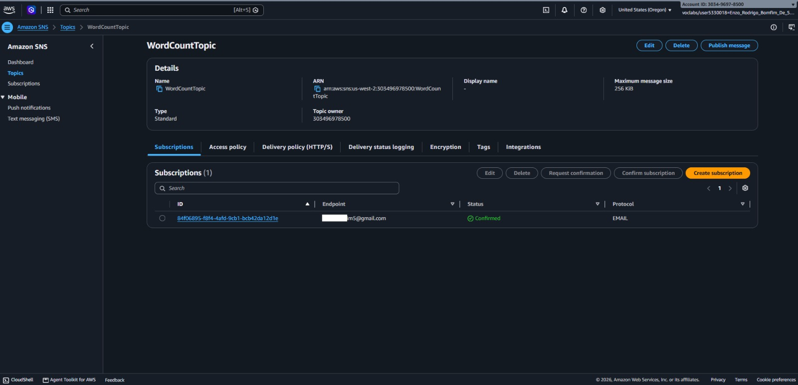
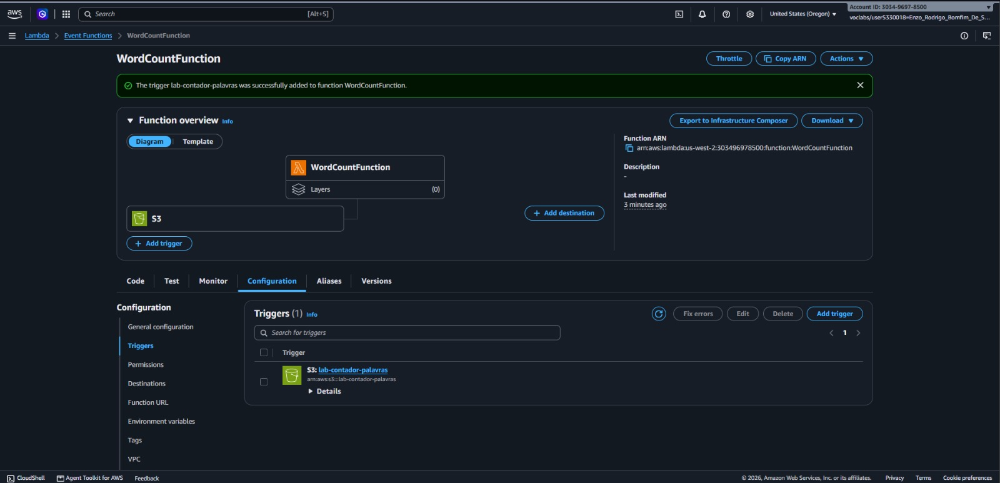
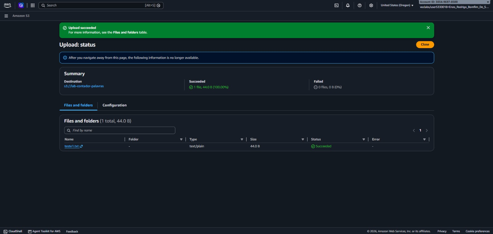
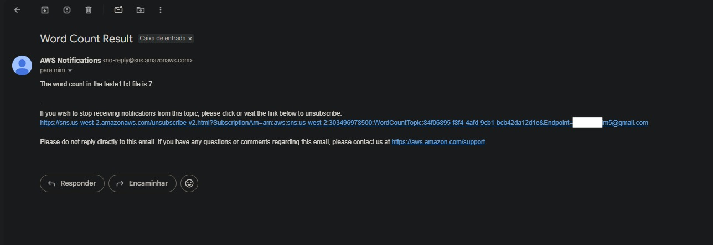

# 📸 Project Implementation & Validation Screenshots

This document provides step-by-step visual evidence of the provisioning, configuration, Python implementation, and end-to-end validation of the **AWS Lambda Word Count Automation** pipeline.

---

## 1. Notification Channel Creation

Creation and configuration of the Amazon SNS topic and email subscription responsible for delivering the formatted word-count result to the subscriber's inbox.

---

## 2. Lambda Provisioning and S3 Integration

Creation of the serverless AWS Lambda function and configuration of the Amazon S3 trigger integration so that object uploads invoke the function automatically.

---

## 3. Test 1 — Text File Upload

Creation and upload of the test `.txt` file containing the seven-word sentence (`This text file contains exactly seven words.`) to the Amazon S3 bucket to trigger the Lambda execution.

---

## 4. Test 2 — Successful Email Notification

Confirmation of the email notification (`Subject: Word Count Result`) delivered via Amazon SNS after the AWS Lambda function processed the uploaded text file.

