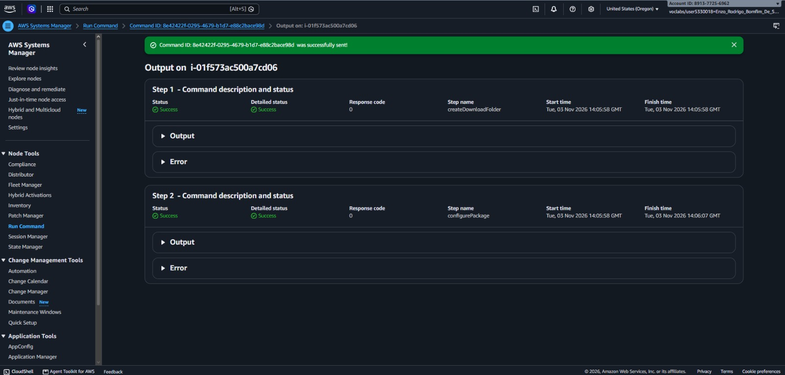
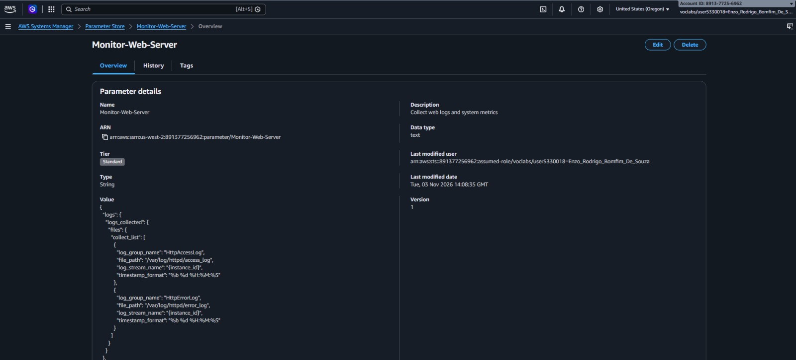
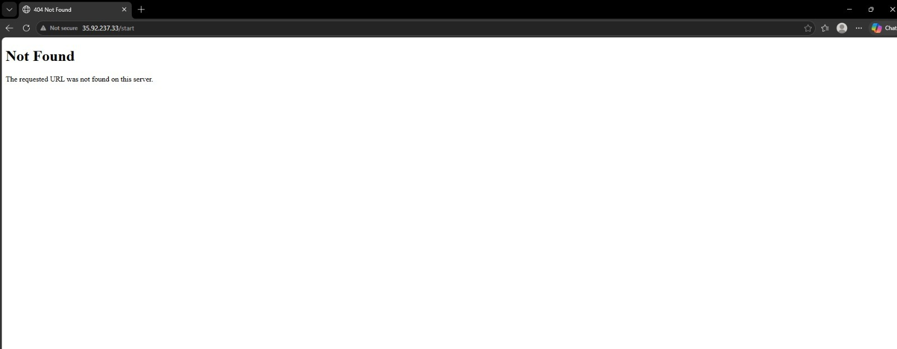
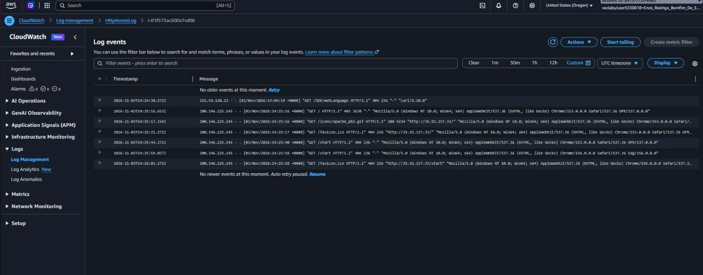
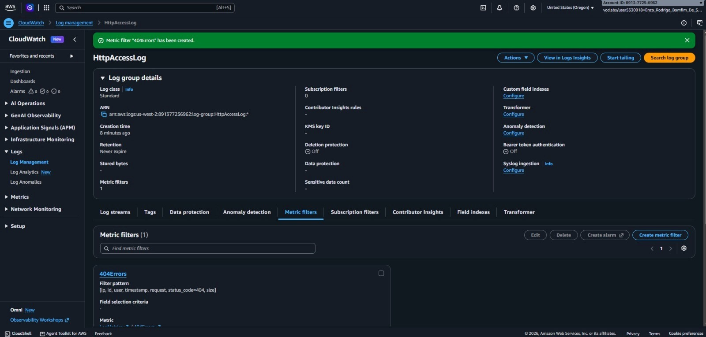
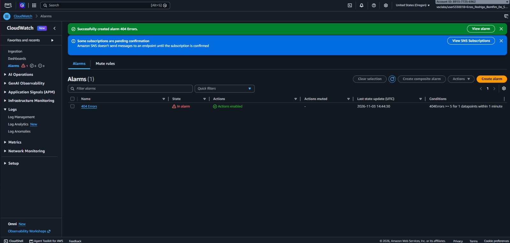
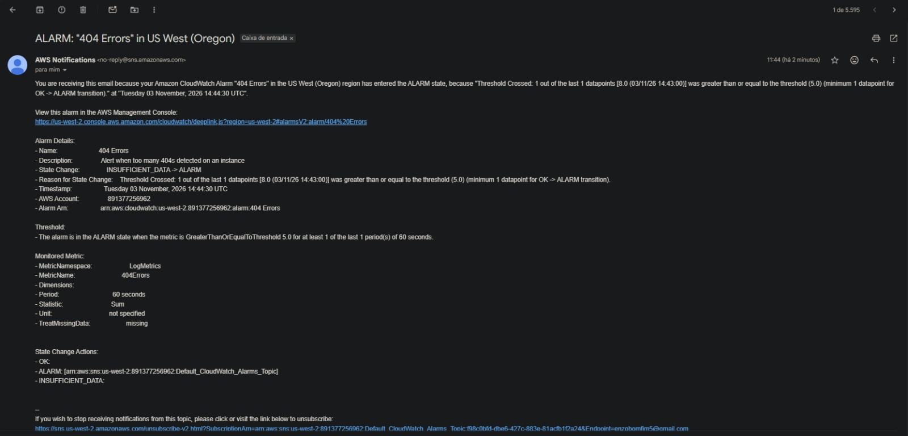
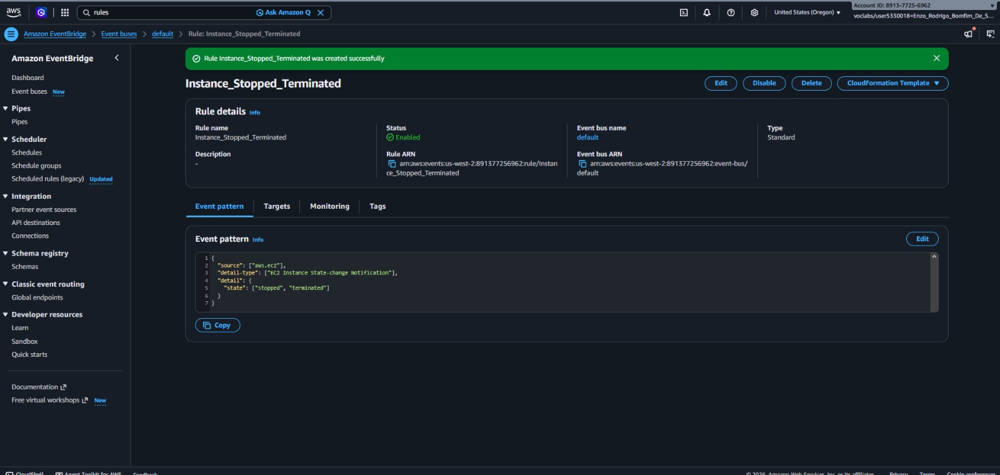
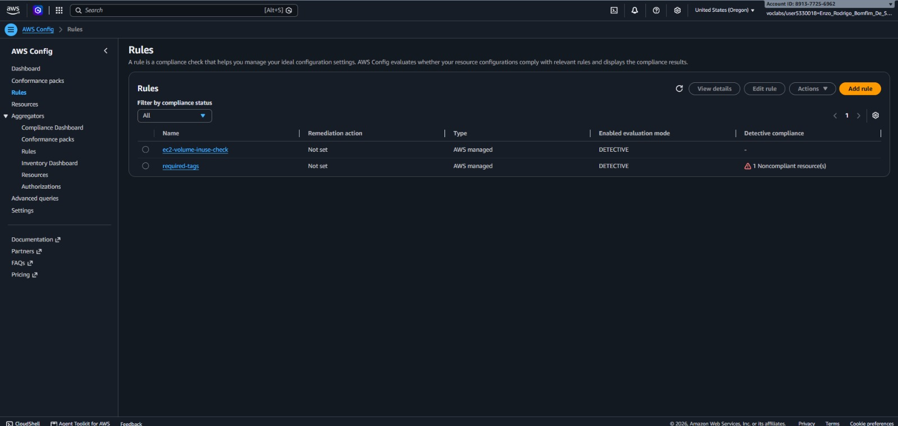

# 📸 Project Implementation & Verification Screenshots

### 1. CloudWatch Agent Installation via SSM Run Command

Execution of the `AWS-ConfigureAWSPackage` document in AWS Systems Manager Run Command to remotely install `AmazonCloudWatchAgent` on the target EC2 instance.

Using Systems Manager Run Command allows automated, agent-based package deployment across instances without requiring inbound SSH access or manual server administration.

### 2. CloudWatch Agent Configuration in Parameter Store

Creation of the `Monitor-Web-Server` JSON configuration parameter in AWS Systems Manager Parameter Store defining log collection paths (`/var/log/httpd/access_log` and `/var/log/httpd/error_log`) and 10-second collection intervals for system metrics.

Storing the agent configuration centrally in Parameter Store decouples monitoring settings from individual instances, enabling consistent deployment across fleets via the `AmazonCloudWatch-ManageAgent` command.

### 3. Web Server HTTP 404 Error Generation Test

Simulating client requests to a non-existent endpoint (`/start`) on the Apache web server to generate HTTP 404 Not Found entries in the access log.

Generating synthetic 404 responses validates that the CloudWatch Agent is actively tailing `/var/log/httpd/access_log` and streaming events to CloudWatch Logs in real time.

### 4. CloudWatch Logs Access Log Stream Verification

Inspection of the instance log stream inside the `HttpAccessLog` log group confirming capture of the `GET /start` request with HTTP status code `404`.

Centralizing server logs in CloudWatch Logs ensures log durability, encryption at rest, and real-time diagnostic visibility without logging into individual compute instances.

### 5. CloudWatch Logs Metric Filter Creation

Configuration of the `404Errors` metric filter using the pattern `[ip, id, user, timestamp, request, status_code=404, size]` mapped to the `LogMetrics` namespace.

Metric filters parse unstructured or space-delimited log streams into numerical CloudWatch metrics, enabling automated threshold evaluation and alerting on application-layer anomalies.

### 6. CloudWatch Alarm State Transition (In Alarm)

The `404 Errors` CloudWatch Alarm transitioning to the red `In alarm` state after detecting 5 or more HTTP 404 errors within a 1-minute evaluation period.

Proactive threshold alarms allow operations teams to immediately identify broken application links, misconfigured deployments, or automated web scanning activity.

### 7. Amazon SNS Real-Time Email Alert Delivery

Confirmation of the `ALARM: "404 Errors"` email notification delivered via Amazon Simple Notification Service (SNS) when the metric breached the defined threshold.

Integrating CloudWatch Alarms with Amazon SNS provides immediate out-of-band alerting to engineering teams and incident response endpoints.

### 8. CloudWatch Events Rule for EC2 State Changes

Configuration of the `Instance_Stopped_Terminated` event rule monitoring `EC2 Instance State-change Notification` events for `stopped` and `terminated` states.

Event-driven monitoring ensures real-time awareness of critical compute lifecycle changes, allowing rapid response to unexpected instance shutdowns or terminations.

### 9. Infrastructure Compliance Auditing with AWS Config

Deployment and evaluation of the `required-tags` (auditing for the `project` key) and `ec2-volume-inuse-check` managed rules in AWS Config.

Continuous configuration auditing enforces organizational tagging standards for cost allocation and detects unattached EBS volumes to eliminate wasted storage spend.

