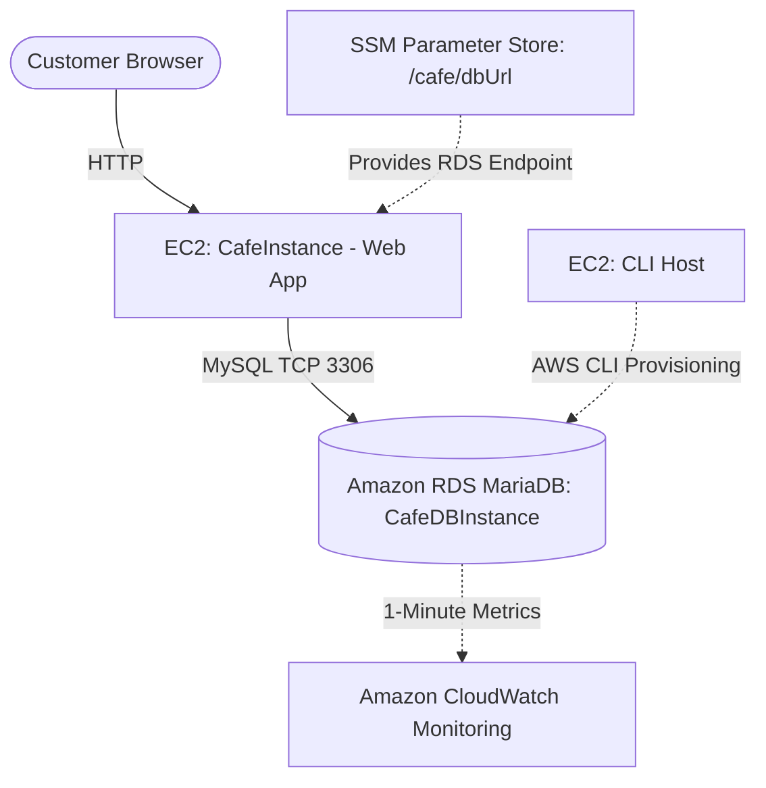

# 🗄️ Database Migration from Amazon EC2 to Amazon RDS (MariaDB)


An end-to-end cloud database migration project that decouples a monolithic **LAMP (Linux, Apache, MySQL/MariaDB, PHP)** web application hosted on **Amazon EC2** by migrating its local relational database (`cafe_db`) to a fully managed **Amazon RDS for MariaDB** instance inside isolated private subnets using the **AWS CLI**, **`mysqldump`**, and **AWS Systems Manager Parameter Store**.

---

## 📌 Project Overview & Objectives

Initially, the Cafe web application ran both its web tier and relational database on a single `t3.small` **Amazon EC2** instance located in a public subnet. This hands-on project modernizes the architecture by provisioning a dedicated, private **Amazon RDS (MariaDB)** instance via the **AWS CLI**, migrating existing transactional data without data loss, reconfiguring application connectivity through **SSM Parameter Store**, and monitoring database performance via **Amazon CloudWatch**.

**Primary Objectives:**
* Provision VPC private subnets across multiple Availability Zones, a DB Subnet Group, and a restrictive VPC Security Group using the **AWS CLI**.
* Deploy a private **Amazon RDS for MariaDB** (`db.t3.micro`) instance via the AWS CLI.
* Export live transactional data from a local EC2 database using `mysqldump` and restore it to Amazon RDS using the `mysql` client.
* Perform application cutover by updating the `/cafe/dbUrl` endpoint in **AWS Systems Manager Parameter Store**.
* Monitor real-time database metrics (`DatabaseConnections`, `CPUUtilization`, `FreeStorageSpace`, `FreeableMemory`, `ReadIOPS`, `WriteIOPS`) with **Amazon CloudWatch**.

---

## ✨ Key Features

* **Database Tier Decoupling:** Separates the stateful MariaDB database from the stateless EC2 web server (`CafeInstance`).
* **Infrastructure Provisioning via AWS CLI:** Automates the creation of security groups, multi-AZ private subnets (`10.200.2.0/23` and `10.200.10.0/23`), DB subnet groups, and the RDS instance through CLI commands.
* **Network Isolation & Least-Privilege Access:** Deploys the RDS instance with `--no-publicly-accessible` in private subnets and restricts inbound TCP port `3306` exclusively to instances attached to `CafeSecurityGroup`.
* **Zero-Code Application Cutover:** Switches the web application from the local database to the Amazon RDS endpoint dynamically by updating `/cafe/dbUrl` in AWS Systems Manager Parameter Store.
* **Real-Time Observability:** Tracks live connection pools and resource utilization metrics in Amazon CloudWatch.

---

## 🏗️ Architecture Evolution (Before vs. After Migration)

### Initial Architecture (Monolithic LAMP on EC2)

```text
+-----------------------------------------------------------------------+
| Cafe VPC (10.200.0.0/20)                                              |
|                                                                       |
|  +-----------------------------------------------------------------+  |
|  | Public Subnet 1 (10.200.0.0/24) - AZ 1                          |  |
|  |                                                                 |  |
|  |  [🖥️ CLI Host (EC2)]        [🌐 CafeInstance (EC2 t3.small)]    |  |
|  |   (AWS CLI Admin)             ├── Apache + PHP Web App          |  |
|  |                               └── Local Database (cafe_db)      |  |
|  +-----------------------------------------------------------------+  |
+-----------------------------------------------------------------------+
```

### Target Architecture (Decoupled Web Tier & Private Amazon RDS)

```text
+-----------------------------------------------------------------------+
| Cafe VPC (10.200.0.0/20)                                              |
|                                                                       |
|  +-----------------------------------------------------------------+  |
|  | Public Subnet 1 (10.200.0.0/24) - AZ 1                          |  |
|  |                                                                 |  |
|  |  [🖥️ CLI Host (EC2)]        [🌐 CafeInstance (EC2 t3.small)]    |  |
|  |   (AWS CLI Admin)             └── Apache + PHP Web App          |  |
|  |                                   (SG: CafeSecurityGroup)       |  |
|  +-------------------------------------------------|---------------+  |
|                                                    |                  |
|                                       TCP 3306     | (Reads /cafe/    |
|                                                    |  dbUrl from SSM) |
|  + - - - - - - - - - - - - - - - - - - - - - - - - | - - - - - - - +  |
|  : CafeDB Subnet Group                             v               :  |
|  : +-------------------------------+  +--------------------------+ :  |
|  : | Private Subnet 1 - AZ 1       |  | Private Subnet 2 - AZ 2  | :  |
|  : | (10.200.2.0/23)               |  | (10.200.10.0/23)         | :  |
|  : |                               |  |                          | :  |
|  : | [🗄️ RDS MariaDB 10.5.13]      |  | (Standby / Multi-AZ      | :  |
|  : |  CafeDBInstance (db.t3.micro) |  |  Subnet Requirement)     | :  |
|  : |  (SG: CafeDatabaseSG)         |  |                          | :  |
|  : +-------------------------------+  +--------------------------+ :  |
|  + - - - - - - - - - - - - - - - - - - - - - - - - - - - - - - - - +  |
+-----------------------------------------------------------------------+
```



---

## 🛠️ AWS Services & Tools Used

| Service / Tool | Role in Architecture |
| :--- | :--- |
| **Amazon RDS (MariaDB)** | Hosts the managed `CafeDBInstance` (`MariaDB 10.5.13`, `db.t3.micro`, 20 GB storage) with automated daily backups. |
| **Amazon EC2** | Runs `CafeInstance` (`t3.small` web server) and `CLI Host` (administration instance for executing AWS CLI commands). |
| **Amazon VPC** | Provides isolated networking (`10.200.0.0/20`), public/private subnet segmentation, and stateful Security Group firewall rules. |
| **AWS Systems Manager (Parameter Store)** | Externalizes the database endpoint parameter (`/cafe/dbUrl`), enabling seamless cutover to Amazon RDS without modifying application code. |
| **Amazon CloudWatch** | Collects and visualizes per-minute RDS telemetries (`DatabaseConnections`, `CPUUtilization`, `FreeStorageSpace`, `FreeableMemory`, `ReadIOPS`, `WriteIOPS`). |
| **AWS CLI & MySQL Utilities** | Automates infrastructure provisioning (`aws ec2`, `aws rds`) and executes logical schema/data migration (`mysqldump` and `mysql`). |

---

## ⚙️ Step-by-Step Implementation

### 1. Pre-Migration Baseline Data Generation
Accessed the Cafe web application (`http://<CafePublicIP>/cafe`), placed orders across menu items to populate the local `cafe_db` database on `CafeInstance`, and recorded the baseline order history count prior to migration.

### 2. Provisioning Network & Security Infrastructure via AWS CLI
Connected to the `CLI Host` EC2 instance via **EC2 Instance Connect**, configured the AWS CLI (`aws configure`), and provisioned the required VPC components:

#### Create the RDS Security Group (`CafeDatabaseSG`)
```bash
aws ec2 create-security-group \
  --group-name CafeDatabaseSG \
  --description "Security group for Cafe database" \
  --vpc-id <CafeInstance_VPC_ID>
```

#### Authorize Inbound MySQL Traffic (TCP 3306) Only from `CafeSecurityGroup`
```bash
aws ec2 authorize-security-group-ingress \
  --group-id <CafeDatabaseSG_Group_ID> \
  --protocol tcp --port 3306 \
  --source-group <CafeSecurityGroup_Group_ID>

# Verify the applied inbound security group rule
aws ec2 describe-security-groups \
  --query "SecurityGroups[*].[GroupName,GroupId,IpPermissions]" \
  --filters "Name=group-name,Values='CafeDatabaseSG'"
```

#### Create Multi-AZ Private Subnets & DB Subnet Group
Designed non-overlapping `/23` CIDR blocks within the `10.200.0.0/20` VPC (alongside the existing `10.200.0.0/24` public subnet):

```bash
# Private Subnet 1 (Same Availability Zone as CafeInstance)
aws ec2 create-subnet \
  --vpc-id <CafeInstance_VPC_ID> \
  --cidr-block 10.200.2.0/23 \
  --availability-zone <CafeInstance_AZ_1>

# Private Subnet 2 (Second Availability Zone for RDS Subnet Group requirement)
aws ec2 create-subnet \
  --vpc-id <CafeInstance_VPC_ID> \
  --cidr-block 10.200.10.0/23 \
  --availability-zone <Alternative_AZ_2>

# Create the RDS DB Subnet Group
aws rds create-db-subnet-group \
  --db-subnet-group-name "CafeDB Subnet Group" \
  --db-subnet-group-description "DB subnet group for Cafe" \
  --subnet-ids <Cafe_Private_Subnet_1_ID> <Cafe_Private_Subnet_2_ID> \
  --tags "Key=Name,Value=CafeDatabaseSubnetGroup"
```

### 3. Provisioning the Amazon RDS MariaDB Instance via AWS CLI
Created the private `CafeDBInstance` running **MariaDB 10.5.13** (`db.t3.micro`, 20 GB storage):

```bash
aws rds create-db-instance \
  --db-instance-identifier CafeDBInstance \
  --engine mariadb \
  --engine-version 10.5.13 \
  --db-instance-class db.t3.micro \
  --allocated-storage 20 \
  --availability-zone <CafeInstance_AZ_1> \
  --db-subnet-group-name "CafeDB Subnet Group" \
  --vpc-security-group-ids <CafeDatabaseSG_Group_ID> \
  --no-publicly-accessible \
  --master-username root \
  --master-user-password '<MASTER_PASSWORD>'
```

Polled the instance provisioning lifecycle (`creating` → `modifying` → `backing-up` → `available`) and retrieved the RDS endpoint address:

```bash
aws rds describe-db-instances \
  --db-instance-identifier CafeDBInstance \
  --query "DBInstances[*].[Endpoint.Address,AvailabilityZone,PreferredBackupWindow,BackupRetentionPeriod,DBInstanceStatus]"
```

### 4. Exporting & Migrating the `cafe_db` Database
Connected to `CafeInstance` via **EC2 Instance Connect** and performed a logical dump and restore over TCP port `3306`:

```bash
# 1. Export the local cafe_db schema and data to a SQL backup file
mysqldump --user=root --password='<MASTER_PASSWORD>' \
  --databases cafe_db --add-drop-database > cafedb-backup.sql

# 2. Inspect the generated DDL and DML statements
less cafedb-backup.sql

# 3. Restore the SQL backup directly to the Amazon RDS MariaDB endpoint
mysql --user=root --password='<MASTER_PASSWORD>' \
  --host=<RDS_Instance_Endpoint_Address> \
  < cafedb-backup.sql
```

### 5. Application Cutover via AWS Systems Manager Parameter Store
Updated the `/cafe/dbUrl` parameter in **AWS Systems Manager Parameter Store** from the local database host to the new Amazon RDS endpoint:

```text
cafedbinstance.xxxxxxx.<region>.rds.amazonaws.com
```

---

## 🧪 Testing, Validation & CloudWatch Monitoring

### 1. Database Migration Verification via SQL CLI
Connected directly from `CafeInstance` to the remote Amazon RDS instance to verify table integrity and product records:

```bash
mysql --user=root --password='<MASTER_PASSWORD>' \
  --host=<RDS_Instance_Endpoint_Address> \
  cafe_db
```

```sql
SELECT * FROM product;
EXIT;
```

### 2. Web Application Cutover Validation
* Reloaded `http://<CafePublicIP>/cafe` after updating `/cafe/dbUrl` in SSM Parameter Store.
* Inspected the **Order History** page and confirmed that all pre-migration orders were intact and served from Amazon RDS.
* Submitted new customer orders through the **Menu** page to confirm read/write functionality against the RDS instance.

### 3. Real-Time Monitoring in Amazon CloudWatch
Monitored key RDS telemetry graphs in the **Amazon RDS / CloudWatch Monitoring** dashboard (`CPUUtilization`, `DatabaseConnections`, `FreeStorageSpace`, `FreeableMemory`, `WriteIOPS`, `ReadIOPS`):
* Opened an interactive `mysql` session from `CafeInstance` to `CafeDBInstance` and ran `SELECT * FROM product;`, confirming the `DatabaseConnections` metric rose to **`1`**.
* Closed the session with `exit`, waited for the 1-minute sampling interval, and verified that `DatabaseConnections` returned to **`0`**.

---

## 🔒 Security Considerations & Potential Improvements

### Implemented Practices
* **Private Subnet Deployment:** Deployed `CafeDBInstance` inside private subnets (`10.200.2.0/23` and `10.200.10.0/23`) with `--no-publicly-accessible` enabled so the database is unreachable from the public internet.
* **Security Group Chaining:** Configured `CafeDatabaseSG` to accept inbound traffic on TCP port `3306` exclusively from resources belonging to `CafeSecurityGroup` rather than broad CIDR ranges.
* **Externalized Configuration:** Stored the database endpoint in **AWS Systems Manager Parameter Store** (`/cafe/dbUrl`).
* **Automated Backups:** Verified automatic daily backups with a configured preferred backup window.

### Potential Future Enhancements (Not Currently Implemented)
* **Multi-AZ High Availability Deployment:** Enable `--multi-az` on `CafeDBInstance` to maintain a synchronous standby replica in the second private subnet (`10.200.10.0/23`) for automatic failover.
* **Extended Backup Retention:** Increase `--backup-retention-period` from the default `1` day to `7–35` days to support longer point-in-time recovery (PITR) windows.
* **Encryption at Rest & In Transit:** Enable AWS KMS storage encryption (`--storage-encrypted`) on the RDS instance and enforce TLS/SSL connections for MySQL client traffic.
* **AWS Secrets Manager Integration:** Migrate master database credentials from static passwords to **AWS Secrets Manager** with automated rotation, and use **AWS DMS (Database Migration Service)** with Change Data Capture (CDC) for near-zero-downtime migrations on large production datasets.

---

## 🎯 Key Technical Skills Demonstrated

* **Cloud Database Migration:** Exporting live relational databases with `mysqldump` and migrating schemas and data to **Amazon RDS (MariaDB)**.
* **VPC Network Design:** Calculating non-overlapping `/23` private subnet CIDRs inside a `/20` VPC, creating multi-AZ DB Subnet Groups, and chaining Security Groups.
* **AWS CLI Infrastructure Automation:** Provisioning EC2 networking and RDS instances end-to-end via the AWS CLI.
* **Configuration Management & Observability:** Performing zero-code application cutovers with **AWS Systems Manager Parameter Store** and validating database connection metrics in **Amazon CloudWatch**.
