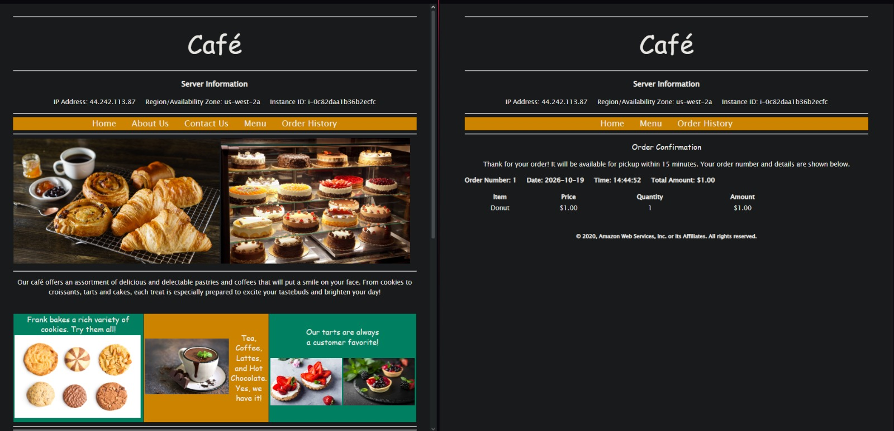
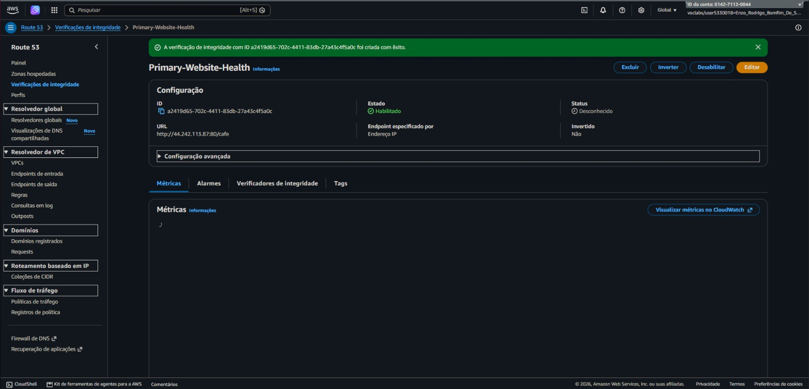
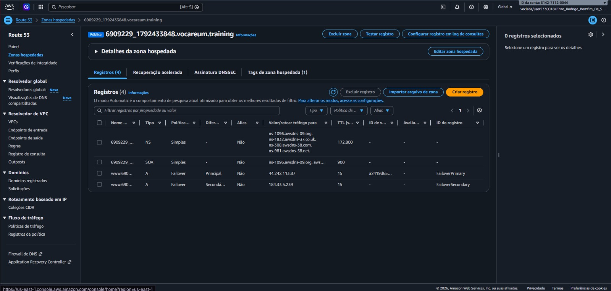
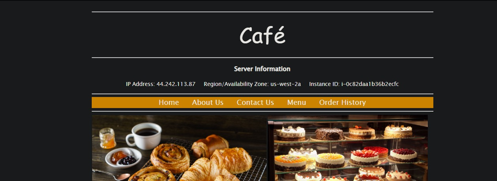
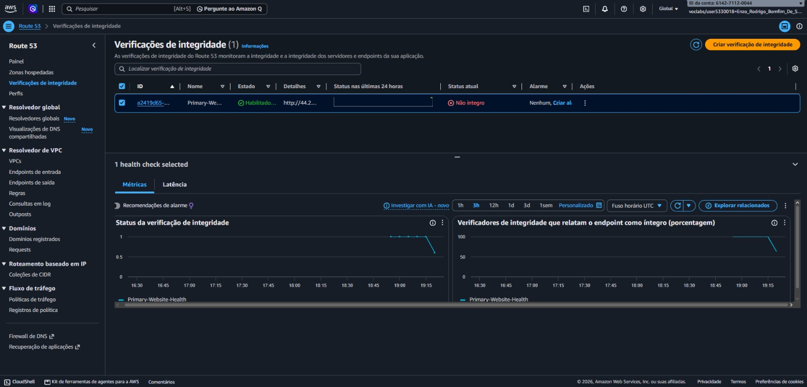
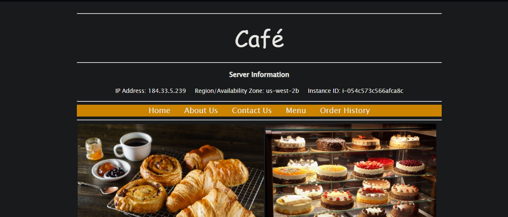

# 📸 Project Implementation & Verification Screenshots

### 1. EC2 Instances Running the Café Web Application

Verification of the pre-provisioned Amazon EC2 instances (`CafeInstance1` and `CafeInstance2`) deployed across two distinct Availability Zones (`us-west-2a` and `us-west-2b`).

Both instances run a complete LAMP stack and actively serve the Café web application, establishing a redundant multi-AZ baseline before configuring DNS failover.

---

### 2. Route 53 Health Check Configuration

Configuration of the `Primary-Website-Health` check in Amazon Route 53 targeting the `/cafe` HTTP endpoint of the primary EC2 instance.

The health check is tuned with a fast `10-second` request interval and a failure threshold of `2`, integrated with an Amazon SNS topic to dispatch immediate email notifications if the primary server becomes unhealthy.

---

### 3. Route 53 Failover DNS Records Creation

Creation of the Primary (`FailoverPrimary`) and Secondary (`FailoverSecondary`) `A` records within the Route 53 Public Hosted Zone using the **Failover** routing policy and a `15-second` TTL.

The primary record is directly linked to the health check monitoring `CafeInstance1`, while the secondary record points to the standby `CafeInstance2` in the secondary Availability Zone.

---

### 4. Failover Test 1: Normal Traffic Routing to Primary AZ (`us-west-2a`)

Initial DNS resolution test accessing the web application via the Route 53 domain name while the primary instance is healthy.

As shown in the Server Information panel, user traffic is actively routed to `CafeInstance1` at IP address **`44.242.113.87`** in Availability Zone **`us-west-2a`**.

---

### 5. Failover Test 2: Simulating Primary Instance Outage

Simulation of an Availability Zone or server failure by manually stopping `CafeInstance1` in the Amazon EC2 console.

Once the instance stops responding to HTTP requests, the Route 53 health check detects two consecutive failures and transitions the endpoint status to `Unhealthy`, triggering the automated DNS failover and SNS alert.

---

### 6. Failover Test 3: Automated DNS Failover to Secondary AZ (`us-west-2b`)

Verification of high availability by refreshing the exact same application URL after the primary instance went offline.

The Server Information panel now displays the IP address of `CafeInstance2` running in Availability Zone **`us-west-2b`**, confirming that Amazon Route 53 automatically redirected user traffic to the standby server without service interruption.

