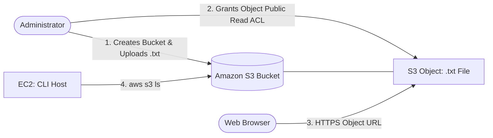

# 🪣 Amazon S3 Object Storage, ACL Permissions & AWS CLI Management


A hands-on cloud storage and access control project on AWS demonstrating how to provision an **Amazon Simple Storage Service (Amazon S3)** bucket, manage object-level public access using **Access Control Lists (ACLs)** without exposing the entire bucket, verify HTTP object delivery via a web browser, and audit bucket contents programmatically from an **Amazon EC2** instance using the **AWS Command Line Interface (AWS CLI)**.

---

## 📌 Project Overview & Objectives

By default, Amazon S3 blocks all public access to newly created buckets and objects. This project explores how to configure granular, object-level permissions when a specific file needs to be publicly readable over HTTPS while keeping the bucket itself restricted, alongside configuring the **AWS CLI** on a Linux administration host (`CLI Host`) to inspect stored objects from the terminal.

**Primary Objectives:**
* Provision a globally unique **Amazon S3** bucket in `us-west-2` configured to support object-level ACLs.
* Upload a `.txt` test object and validate S3 default private access controls.
* Grant public read access exclusively to the individual object (rather than the entire bucket) via S3 ACLs and verify access in a web browser.
* Connect to an **Amazon EC2 (`CLI Host`)** instance via **EC2 Instance Connect**, configure the **AWS CLI**, and list bucket objects with metadata (date, time, size in bytes, and object key).

---

## ✨ Key Features

* **Granular Object-Level Access Control:** Enables ACLs at bucket creation so individual objects can be made public (`Make public using ACL`) without applying a broad public bucket policy.
* **Direct HTTPS Object Delivery:** Serves the uploaded `.txt` object directly to web browsers via its public Amazon S3 Object URL.
* **EC2-Based AWS CLI Administration:** Configures credential profiles (`aws configure`) for region `us-west-2` and JSON output on a Linux EC2 host.
* **Programmatic Bucket Auditing:** Queries S3 bucket contents via the AWS CLI, returning creation timestamps, payload sizes in bytes, and filenames.

---

## 🏗️ Architecture & Workflow

```text
+-------------------------------------------------------------------------+
| AWS Cloud (Region: us-west-2)                                           |
|                                                                         |
|  [ 👤 Cloud Administrator ]                                             |
|        │                                                                |
|        ├──(1. Creates Bucket with ACLs enabled & uploads .txt)──┐       |
|        │                                                        ▼       |
|        │                                            [ 🪣 Amazon S3 ]    |
|        ├──(2. Enables Public Read ACL on Object)───►  Bucket            |
|        │                                              └── test-file.txt |
|        │                                                    │     ▲     |
|        ▼                                 (3. HTTPS GET      │     │     |
|  [ 🌐 Web Browser ] ◄──────────────────────── Object URL)───┘     │     |
|                                                                   │     |
|  [ 🖥️ EC2: CLI Host ] ───(4. aws s3 ls s3://<bucket-name>)────────┘     |
|   (EC2 Instance Connect)                                                |
+-------------------------------------------------------------------------+
```



### Step-by-Step Workflow
1. **Bucket Creation & Object Upload:** An Amazon S3 bucket is created in `us-west-2` with ACLs enabled and Block Public Access settings adjusted to allow object-level ACLs. A `.txt` test file is uploaded to the bucket.
2. **Object-Level Permission Update:** Attempting to open the Object URL initially fails because S3 objects are private by default. Public read permission is then granted specifically on the `.txt` object via its ACL (`Make public using ACL`).
3. **Browser Verification:** Accessing the S3 Object URL in a web browser renders the plaintext content of the `.txt` file over HTTPS.
4. **CLI Inspection:** From the `CLI Host` EC2 terminal, the `aws s3 ls` command queries the bucket and outputs the upload date, time, file size in bytes, and filename.

---

## 🛠️ AWS Services & Tools Used

| Service / Tool | Role in Project |
| :--- | :--- |
| **Amazon S3** | Provides durable object storage for the uploaded `.txt` file and enforces bucket/object ACL permissions. |
| **Amazon EC2 (`CLI Host`)** | Provides the Linux administration environment accessed via **EC2 Instance Connect** to run AWS CLI commands. |
| **AWS CLI** | Authenticates to the AWS account (`aws configure`) and queries S3 bucket contents (`aws s3 ls`) from the command line. |
| **AWS IAM** | Supplies the `AccessKey` and `SecretKey` credentials used to authenticate the AWS CLI session. |

---

## ⚙️ Step-by-Step Implementation

### 1. Connecting to the CLI Host & Configuring the AWS CLI
Connected to the `CLI Host` Amazon EC2 instance using **EC2 Instance Connect** and configured the default AWS CLI profile:

```bash
aws configure
```

Configured parameters:
* **AWS Access Key ID:** `<AccessKey>`
* **AWS Secret Access Key:** `<SecretKey>`
* **Default region name:** `us-west-2`
* **Default output format:** `json`

### 2. Provisioning the S3 Bucket & Uploading the Test Object
* Created a uniquely named Amazon S3 bucket in `us-west-2`.
* Enabled **Object Ownership → ACLs enabled** and configured **Block Public Access** settings to permit public access granted through object ACLs.
* Uploaded a `.txt` test file to the bucket.

*(Equivalent AWS CLI commands for reference):*
```bash
# Create the bucket in us-west-2 with ACLs enabled
aws s3api create-bucket \
  --bucket <bucket-name> \
  --region us-west-2 \
  --create-bucket-configuration LocationConstraint=us-west-2 \
  --object-ownership ObjectWriter

# Upload the test .txt file
aws s3 cp <test-file.txt> s3://<bucket-name>/
```

### 3. Configuring Object-Level Public Read Access
* Tested the **Object URL** in a browser immediately after upload to verify that default private permissions blocked anonymous access (`AccessDenied`).
* Selected the `.txt` object in the Amazon S3 console, navigated to **Permissions / Actions → Make public using ACL**, and confirmed public read access for the individual object while leaving the bucket itself non-public.

### 4. Listing Bucket Contents via AWS CLI
From the `CLI Host` terminal, listed the objects inside the bucket to verify the stored metadata:

```bash
# List all buckets in the account
aws s3 ls

# List the contents of the target bucket (returns date, time, size in bytes, and filename)
aws s3 ls s3://<bucket-name>/
```

---

## 🧪 Testing & Validation

### Test 1 — Browser Access to the Public Object URL
Opened the S3 Object URL (`https://<bucket-name>.s3.us-west-2.amazonaws.com/<test-file.txt>`) in a web browser after enabling the object-level public ACL. The browser successfully loaded and displayed the contents of the `.txt` file.

### Test 2 — AWS CLI Object Verification
Executed `aws s3 ls s3://<bucket-name>/` on the `CLI Host` EC2 instance. The terminal returned the exact upload date, timestamp, file size in bytes, and filename of the uploaded `.txt` object:

```text
YYYY-MM-DD HH:MM:SS         <bytes> <test-file.txt>
```

---

## 📸 Implementation Screenshots

Complete visual evidence of the S3 bucket provisioning, browser validation, and AWS CLI output is available in the [**screenshots/**](./screenshots/) directory:

1. [S3 Bucket Creation with ACL Support and `.txt` File Upload](./screenshots/SCREENSHOTS.md#1-s3-bucket-creation-with-acl-support-and-txt-file-upload)
2. [Browser Displaying `.txt` Object Content After Enabling Public ACL](./screenshots/SCREENSHOTS.md#2-browser-displaying-txt-object-content-after-enabling-public-acl)
3. [AWS CLI Listing Bucket Contents in the Terminal](./screenshots/SCREENSHOTS.md#3-aws-cli-listing-bucket-contents-in-the-terminal)

---

## 🔒 Security Considerations & Potential Improvements

### Implemented Practices
* **Object-Scoped Exposure:** Only the single target `.txt` object was granted public read permission via ACL, preventing anonymous listing or access to other objects in the bucket.

### Potential Future Enhancements (Not Currently Implemented)
* **Amazon CloudFront with Origin Access Control (OAC):** Keep S3 **Block Public Access** fully enabled (`Bucket owner enforced` with ACLs disabled) and serve public files through an Amazon CloudFront distribution using OAC.
* **Amazon S3 Pre-Signed URLs:** Generate temporary, time-limited pre-signed URLs (`aws s3 presign`) when sharing individual files rather than making objects permanently public.
* **IAM Roles for EC2:** Attach an IAM Instance Profile to the `CLI Host` EC2 instance instead of configuring static access keys via `aws configure`.

---

## 🎯 Key Technical Skills Demonstrated

* **Amazon S3 Administration:** Provisioning buckets, managing Block Public Access settings, and configuring object-level ACLs.
* **Access Control Verification:** Testing anonymous HTTP object retrieval before and after permission changes.
* **AWS CLI & Linux Operations:** Connecting to EC2 instances via EC2 Instance Connect, configuring CLI profiles, and auditing S3 storage from the command line.
