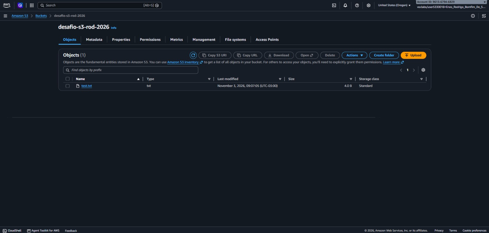
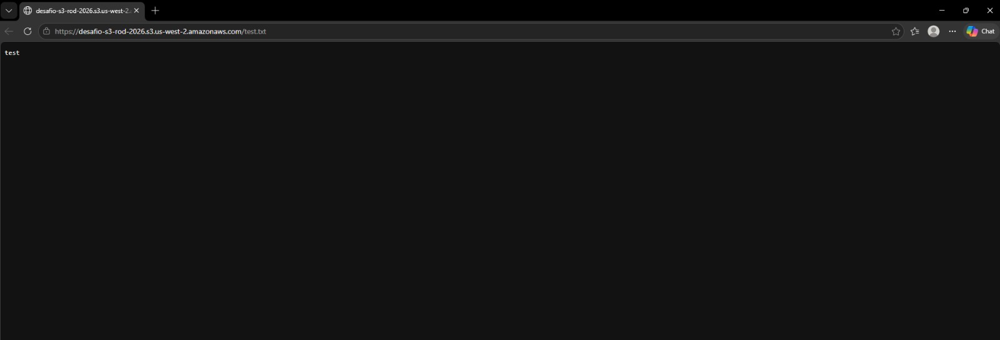
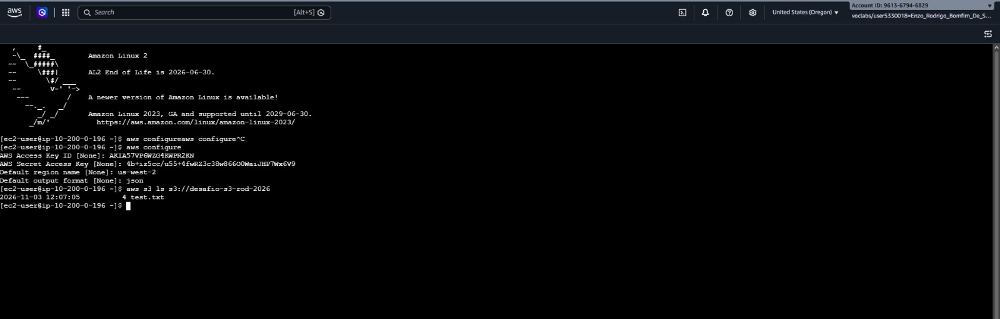

# 📸 Project Implementation & Validation Screenshots

This document provides step-by-step visual evidence of the bucket configuration, object-level public access validation, and AWS CLI inspection for the **Amazon S3 Object Storage, ACL Permissions & AWS CLI Management** project.

---

## 1. S3 Bucket Creation with ACL Support and `.txt` File Upload

Provisioning of the Amazon S3 bucket configured to allow object-level ACL permissions and upload of the `.txt` test file into the bucket.

---

## 2. Browser Displaying `.txt` Object Content After Enabling Public ACL

Verification in the web browser showing the plaintext content of the uploaded `.txt` file accessed directly via its S3 Object URL after granting public read access on the object.

---

## 3. AWS CLI Listing Bucket Contents in the Terminal

Execution of the AWS CLI command on the `CLI Host` terminal returning the upload date, time, file size in bytes, and filename of the `.txt` object stored in the S3 bucket.

