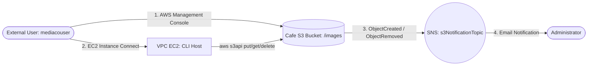

# 🪣 Amazon S3 Secure Partner File Sharing, IAM Prefix Isolation & SNS Event Notifications


A cloud storage security and event-driven notification project on AWS demonstrating how to configure an **Amazon S3** bucket for external partner collaboration (`mediacouser`) using prefix-scoped **AWS IAM** policies (`images/*`), manage objects via both the **AWS Management Console** and **AWS CLI (`s3` and `s3api`)**, and automate real-time **Amazon SNS** email alerts whenever bucket objects are created or deleted.

---

## 📌 Project Overview & Objectives

In this scenario, a café needs to share a dedicated folder (`/images`) inside an **Amazon S3** bucket with an external media partner (`mediacouser`) responsible for uploading, updating, and removing product photography. To maintain strict security governance, the external user must only be permitted to perform object operations within the `images/` prefix—without permission to modify bucket-level security settings or object ACLs—while an administrator receives automated email notifications via **Amazon SNS** whenever images are added or deleted.

**Primary Objectives:**
* Provision an **Amazon S3** bucket (`cafe-xxxnnn`) and synchronize initial product images into the `/images` prefix using the **AWS CLI** (`aws s3 mb`, `aws s3 sync`, `aws s3 ls`).
* Audit and validate **AWS IAM** group-based permissions (`mediaco` group and `mediaCoPolicy`) enforcing least-privilege access scoped to `cafe-*/images/*`.
* Configure an **Amazon SNS** topic (`s3NotificationTopic`) with a resource-based access policy authorizing `s3.amazonaws.com` to publish events from the bucket.
* Apply an S3 event notification filter (`s3EventNotification.json`) via `aws s3api put-bucket-notification-configuration` to trigger alerts on `s3:ObjectCreated:*` and `s3:ObjectRemoved:*` events.
* Validate authorized (`put-object`, `get-object`, `delete-object`) and unauthorized (`put-object-acl`, bucket permissions view) operations as `mediacouser`.

---

## ✨ Key Features

* **Prefix-Level IAM Isolation:** Restricts external partner operations (`GetObject`, `PutObject`, `DeleteObject`) strictly to the `cafe-*/images/*` prefix while denying bucket-wide permission changes and ACL modifications.
* **Event-Driven Change Auditing:** Automatically publishes JSON event payloads to **Amazon SNS** whenever objects are uploaded or removed inside `images/`, while ignoring read-only (`GetObject`) operations.
* **Resource-Based SNS Topic Security:** Uses an explicit `aws:SourceArn` condition in the SNS topic policy so only the designated S3 bucket can publish messages to `s3NotificationTopic`.
* **Dual-Interface Operations:** Validates partner access workflows across both the **AWS Management Console** and the **AWS CLI (`s3api`)** from an Amazon EC2 administration host.

---

## 🏗️ Architecture & Event Notification Workflow

```text
+-----------------------------------------------------------------------------------+
| AWS Cloud (Region: us-west-2)                                                     |
|                                                                                   |
|  [ 👤 External Partner: mediacouser ] (Member of IAM Group: mediaco)              |
|        │                                                                          |
|        ├── (1. Console Sign-In: View, Upload, Delete in /images) ────────┐        |
|        │                                                                 ▼        |
|        └── (2. EC2 Instance Connect) ──► [ 🖥️ CLI Host (EC2 in VPC) ]    [ 🪣 Cafe S3 Bucket ]
|                                                │                         └── /images/*
|                                                └── (aws s3api commands) ─┘     │
|                                                                                │
|      (3. Triggers on s3:ObjectCreated:* & s3:ObjectRemoved:* in images/)       │
|                                                                                ▼
|  [ 📧 Administrator Inbox ] ◄── (4. Email Alert) ── [ 📢 SNS: s3NotificationTopic ]
+-----------------------------------------------------------------------------------+
```



### Step-by-Step Workflow
1. **Console Access:** The external media partner signs in to the AWS Management Console as `mediacouser` to view, upload, or delete product photos inside the `images/` prefix of the Cafe S3 bucket.
2. **CLI Access:** Alternatively, `mediacouser` executes programmatic `aws s3api` commands from the `CLI Host` EC2 instance using scoped IAM access keys.
3. **S3 Event Detection:** When Amazon S3 detects an `s3:ObjectCreated:*` or `s3:ObjectRemoved:*` event matching the `images/` prefix filter, it publishes an event payload to the `s3NotificationTopic` Amazon SNS topic.
4. **Administrator Notification:** Amazon SNS delivers an email containing the event metadata (such as `ObjectCreated:Put` or `ObjectRemoved:Delete`, bucket name, and object key) to the subscribed Administrator.

---

## 🛠️ AWS Services Used

| AWS Service | Role in Architecture |
| :--- | :--- |
| **Amazon S3** | Hosts the `cafe-xxxnnn` bucket, stores product images under `/images`, and triggers event notifications on object creation and removal. |
| **AWS IAM** | Manages the `mediaco` user group, the `mediacouser` identity, CLI access keys, and the custom `mediaCoPolicy` least-privilege policy. |
| **Amazon SNS** | Hosts the standard topic `s3NotificationTopic`, enforces the `S3PublishPolicy` access policy, and delivers email notifications to the Administrator. |
| **Amazon EC2 (`CLI Host`)** | Provides the Linux terminal environment in the VPC accessed via EC2 Instance Connect to run `aws s3` and `aws s3api` commands. |
| **AWS CLI** | Automates bucket creation, directory synchronization, notification configuration, and IAM user permission testing. |

---

## 🔐 IAM Policy Design (`mediaco` Group — `mediaCoPolicy`)

The `mediacouser` user inherits permissions from the `mediaco` IAM group, which attaches `IAMUserChangePassword` and `mediaCoPolicy`. `mediaCoPolicy` enforces three specific security statements:

| Statement ID (`Sid`) | Granted Permissions & Scope |
| :--- | :--- |
| **`AllowGroupToSeeBucketListInTheConsole`** | Allows listing all S3 buckets in the account (`s3:ListAllMyBuckets`, `s3:GetBucketLocation`) so the user can navigate the S3 console. |
| **`AllowRootLevelListingOfTheBucket`** | Allows listing root-level contents of the `cafe-*` bucket (`s3:ListBucket`) to navigate into the `images/` folder. |
| **`AllowUserSpecificActionsOnlyInTheSpecificPrefix`** | Grants `s3:GetObject`, `s3:PutObject`, `s3:DeleteObject` (and version equivalents) strictly on `arn:aws:s3:::cafe-*/images/*`. Denies any bucket policy/ACL modifications or uploads outside `images/`. |

---

## ⚙️ Step-by-Step Implementation

### 1. Creating & Initializing the S3 Share Bucket via AWS CLI
Connected to `CLI Host` via **EC2 Instance Connect**, configured the administrator AWS CLI profile for `us-west-2`, created the bucket, and synced the initial product catalog images:

```bash
# 1. Configure administrator CLI credentials
aws configure

# 2. Create the globally unique Cafe S3 bucket in us-west-2
aws s3 mb s3://<cafe-xxxnnn> --region 'us-west-2'

# 3. Synchronize initial product images into the /images prefix
aws s3 sync ~/initial-images/ s3://<cafe-xxxnnn>/images

# 4. Verify uploaded objects, human-readable sizes, and total summary
aws s3 ls s3://<cafe-xxxnnn>/images/ --human-readable --summarize
```

### 2. Configuring the Amazon SNS Topic & Resource Policy (`s3NotificationTopic`)
Created a Standard SNS topic named `s3NotificationTopic`, subscribed the Administrator email address, and attached the following resource-based access policy allowing Amazon S3 to publish messages from the bucket:

```json
{
  "Version": "2008-10-17",
  "Id": "S3PublishPolicy",
  "Statement": [
    {
      "Sid": "AllowPublishFromS3",
      "Effect": "Allow",
      "Principal": {
        "Service": "s3.amazonaws.com"
      },
      "Action": "SNS:Publish",
      "Resource": "<ARN of s3NotificationTopic>",
      "Condition": {
        "ArnLike": {
          "aws:SourceArn": "arn:aws:s3:*:*:<cafe-xxxnnn>"
        }
      }
    }
  ]
}
```

### 3. Applying the S3 Event Notification Configuration via `s3api`
Created `s3EventNotification.json` on `CLI Host` to monitor object creation and deletion events inside the `images/` prefix:

```json
{
  "TopicConfigurations": [
    {
      "TopicArn": "<ARN of s3NotificationTopic>",
      "Events": ["s3:ObjectCreated:*", "s3:ObjectRemoved:*"],
      "Filter": {
        "Key": {
          "FilterRules": [
            {
              "Name": "prefix",
              "Value": "images/"
            }
          ]
        }
      }
    }
  ]
}
```

Applied the notification configuration to the S3 bucket:

```bash
aws s3api put-bucket-notification-configuration \
  --bucket <cafe-xxxnnn> \
  --notification-configuration file://s3EventNotification.json
```

Upon applying the configuration, Amazon S3 automatically dispatched a verification payload (`"Event": "s3:TestEvent"`) to `s3NotificationTopic`.

---

## 🧪 Testing & Validation (`mediacouser` Permissions & Event Alerts)

### Phase 1 — AWS Management Console Testing as `mediacouser`
Signed in to the AWS Console in an incognito session using `mediacouser` credentials:
* **View Object (`GetObject`):** Opened `images/Donuts.jpg` in the browser — **Succeeded**.
* **Upload Object (`PutObject`):** Uploaded a new image into `images/` — **Succeeded**.
* **Delete Object (`DeleteObject`):** Deleted `images/Cup-of-Hot-Chocolate.jpg` — **Succeeded**.
* **Unauthorized Bucket Permission Access:** Navigated to the bucket's **Permissions** tab — **Blocked** with `"Insufficient permissions"` / `Access Denied`.

### Phase 2 — AWS CLI (`s3api`) Testing & Notification Verification
Switched the `CLI Host` profile (`aws configure`) to use `mediacouser`'s IAM Access Keys and executed four operational tests:

```bash
# Test 1: Upload a new image (Triggers ObjectCreated:Put email via SNS)
aws s3api put-object \
  --bucket <cafe-xxxnnn> \
  --key images/Caramel-Delight.jpg \
  --body ~/new-images/Caramel-Delight.jpg

# Test 2: Download an existing image (Succeeds silently; no email triggered for GetObject)
aws s3api get-object \
  --bucket <cafe-xxxnnn> \
  --key images/Donuts.jpg Donuts.jpg

# Test 3: Delete an existing image (Triggers ObjectRemoved:Delete email via SNS)
aws s3api delete-object \
  --bucket <cafe-xxxnnn> \
  --key images/Strawberry-Tarts.jpg

# Test 4: Attempt unauthorized ACL modification (Blocked with AccessDenied)
aws s3api put-object-acl \
  --bucket <cafe-xxxnnn> \
  --key images/Donuts.jpg \
  --acl public-read
```

### Summary of Test Results

| Test Case | Operation / Command | Execution Result | SNS Email Notification |
| :--- | :--- | :--- | :--- |
| ** Notification Setup** | `put-bucket-notification-configuration` | Configuration applied | Sent `"Event": "s3:TestEvent"` |
| **Put Object** | `s3api put-object` (`images/Caramel-Delight.jpg`) | Returned object `ETag` | Sent `"eventName": "ObjectCreated:Put"` |
| **Get Object** | `s3api get-object` (`images/Donuts.jpg`) | Downloaded locally | **None** (Read events excluded by design) |
| **Delete Object** | `s3api delete-object` (`images/Strawberry-Tarts.jpg`) | Object deleted | Sent `"eventName": "ObjectRemoved:Delete"` |
| **Modify Object ACL** | `s3api put-object-acl --acl public-read` | **Blocked:** `(AccessDenied) when calling the PutObjectAcl operation` | **None** |

---

## 📸 Implementation Screenshots

Complete visual evidence of the S3 bucket initialization, IAM permission enforcement, SNS configuration, and CLI test executions is available in the [**screenshots/**](./screenshots/) directory:

1. [S3 Bucket Creation and Initial Images Sync via AWS CLI](./screenshots/SCREENSHOTS.md#1-s3-bucket-creation-and-initial-images-sync-via-aws-cli)
2. [IAM Validation: `mediacouser` Blocked from Modifying Bucket Permissions](./screenshots/SCREENSHOTS.md#2-iam-validation--mediacouser-blocked-from-modifying-bucket-permissions)
3. [Amazon SNS Topic Creation and S3 Publish Access Policy](./screenshots/SCREENSHOTS.md#3-amazon-sns-topic-creation-and-s3-publish-access-policy)
4. [Initial S3 Event Notification Test Email (`s3:TestEvent`)](./screenshots/SCREENSHOTS.md#4-initial-s3-event-notification-test-email-s3testevent)
5. [CLI Testing as `mediacouser`: `get-object` and `delete-object` Operations](./screenshots/SCREENSHOTS.md#5-cli-testing-as-mediacouser--get-object-and-delete-object-operations)
6. [SNS Email Alert Received for `ObjectRemoved:Delete` Event](./screenshots/SCREENSHOTS.md#6-sns-email-alert-received-for-objectremoveddelete-event)
7. [Unauthorized `put-object-acl` Attempt Blocked (`AccessDenied`)](./screenshots/SCREENSHOTS.md#7-unauthorized-put-object-acl-attempt-blocked-accessdenied)

---

## 🔒 Security Considerations & Potential Improvements

### Implemented Practices
* **Least-Privilege Prefix Scoping:** `mediacouser` can only read, write, and delete objects inside `cafe-*/images/*` and cannot view or alter bucket security settings or object ACLs.
* **Condition-Restricted SNS Policy:** The `s3NotificationTopic` policy restricts `SNS:Publish` to `s3.amazonaws.com` only when `aws:SourceArn` matches the specific Cafe S3 bucket ARN.
* **Noise-Free Alerting:** S3 Event Notifications are filtered by both event type (`ObjectCreated:*`, `ObjectRemoved:*`) and key prefix (`images/`).

### Potential Future Enhancements (Not Currently Implemented)
* **S3 Versioning & MFA Delete:** Enable S3 Versioning on the bucket so accidental or malicious deletions by external users (`ObjectRemoved:Delete`) can be easily restored from previous object versions.
* **IAM Roles / Pre-Signed URLs Instead of Long-Term Access Keys:** Replace static IAM user access keys (`mediacouser_accessKeys.csv`) with temporary credentials via **AWS IAM Identity Center**, **STS AssumeRole**, or **S3 Pre-Signed URLs**.
* **Human-Readable Formatting via AWS Lambda:** Route S3 events through an **AWS Lambda** function or **Amazon EventBridge Input Transformer** before publishing to SNS so administrators receive formatted summary emails rather than raw JSON payloads.

---

## 🎯 Key Technical Skills Demonstrated

* **Amazon S3 & Event-Driven Architecture:** Configuring S3 prefix-filtered event notifications integrated with Amazon SNS.
* **AWS IAM Security Auditing:** Analyzing group-inherited policies, resource-level ARNs, prefix wildcards (`images/*`), and SNS resource-based trust policies.
* **AWS CLI (`s3` & `s3api`) Operations:** Managing buckets and objects using both high-level (`aws s3 mb`, `sync`, `ls`) and low-level (`aws s3api put-bucket-notification-configuration`, `put-object`, `get-object`, `delete-object`, `put-object-acl`) commands.
* **Security & Negative Testing:** Validating least-privilege controls by testing unauthorized privilege escalation attempts (`PutObjectAcl` and bucket permission views).
