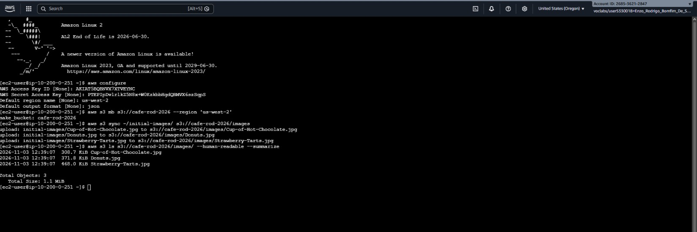
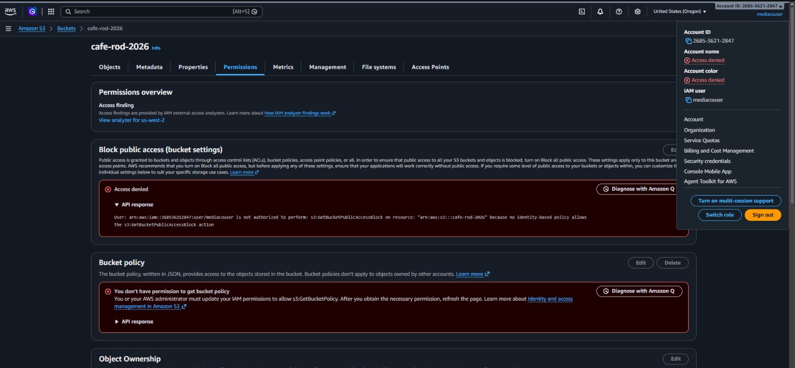
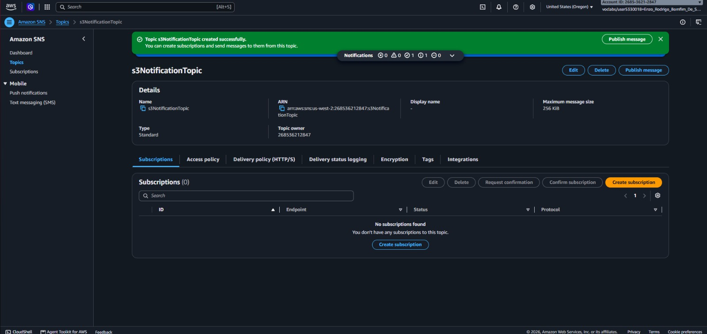
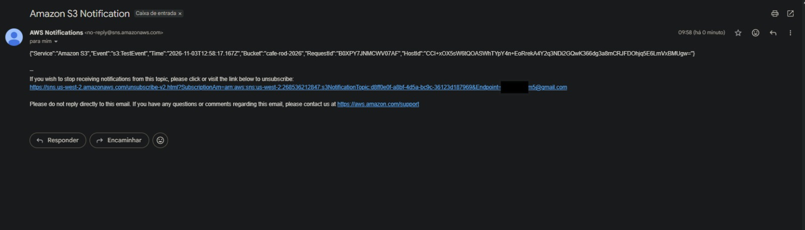
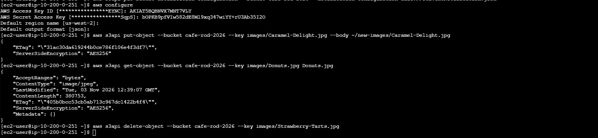
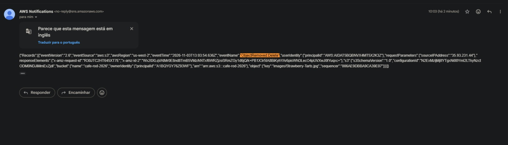
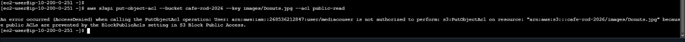

# 📸 Project Implementation & Validation Screenshots

This document provides step-by-step visual evidence of the S3 bucket provisioning, IAM permission validation, Amazon SNS event notification setup, and AWS CLI security testing for the **Amazon S3 Secure Partner File Sharing, IAM Prefix Isolation & SNS Event Notifications** project.

---

## 1. S3 Bucket Creation and Initial Images Sync via AWS CLI

Creation of the Cafe Amazon S3 bucket from the `CLI Host` terminal using `aws s3 mb` and synchronization of the initial product images into the `/images` prefix using `aws s3 sync` and `aws s3 ls`.

---

## 2. IAM Validation — `mediacouser` Blocked from Modifying Bucket Permissions

Verification in the Amazon S3 Console while signed in as `mediacouser` showing `Insufficient permissions` / `Access Denied` warnings under the bucket Permissions tab, proving that the external user cannot alter bucket-level security settings.

---

## 3. Amazon SNS Topic Creation and S3 Publish Access Policy

Creation of the `s3NotificationTopic` standard Amazon SNS topic and configuration of its access policy (`S3PublishPolicy`) authorizing the Cafe S3 bucket to publish event notifications to the Administrator.

---

## 4. Initial S3 Event Notification Test Email (`s3:TestEvent`)

Confirmation of the initial `Amazon S3 Notification` test email (`"Event": "s3:TestEvent"`) delivered via Amazon SNS immediately after applying `s3EventNotification.json` to the S3 bucket.

---

## 5. CLI Testing as `mediacouser` — `get-object` and `delete-object` Operations

Configuring the AWS CLI with `mediacouser` credentials, downloading `images/Donuts.jpg` (`aws s3api get-object`, which succeeds without triggering an email alert), and deleting `images/Strawberry-Tarts.jpg` (`aws s3api delete-object`, which triggers an SNS removal notification).

---

## 6. SNS Email Alert Received for `ObjectRemoved:Delete` Event

Verification of the Amazon SNS email notification received by the Administrator reporting the `"eventName": "ObjectRemoved:Delete"` event for `images/Strawberry-Tarts.jpg`.

---

## 7. Unauthorized `put-object-acl` Attempt Blocked (`AccessDenied`)

Negative security test executing `aws s3api put-object-acl --acl public-read` as `mediacouser`, confirming the terminal returns the expected `An error occurred (AccessDenied) when calling the PutObjectAcl operation: Access Denied` error.

