# 📸 Project Implementation & Verification Screenshots

### 1. Restricted SSH Security Group Configuration

Configuration of the EC2 Security Group inbound rules to allow TCP port `22` (SSH) exclusively from the administrator's `/32` public IP address alongside TCP port `80` (HTTP).

Enforcing least-privilege network access at the Security Group boundary prevents unauthorized external hosts from attempting remote administrative connections.

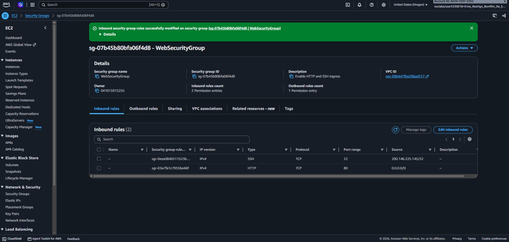

### 2. Web Application Baseline Verification

Verification of the web application (`/cafe/`) rendering normally over HTTP prior to the simulated security incident.

Establishing a known-good operational baseline confirms that both web server assets and inbound HTTP routing are functioning as expected.

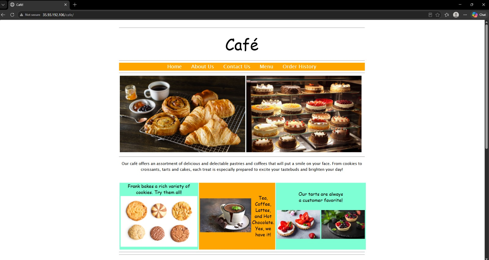

### 3. AWS CloudTrail Trail Creation with S3 and KMS

Creation of the `monitor` trail in AWS CloudTrail configured to deliver KMS-encrypted management event logs to a dedicated Amazon S3 bucket (`monitoring####`).

Continuous CloudTrail logging provides a tamper-evident audit trail of all API calls, user identities, and configuration changes across the AWS account.

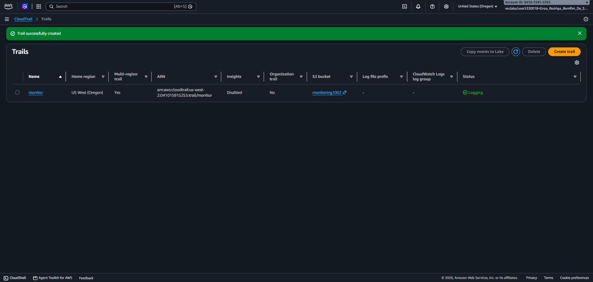

### 4. Web Application Defacement Detection

Observation of the compromised web application displaying an unauthorized image on the main landing page.

Detecting visual tampering at the application layer triggers the forensic investigation workflow to determine both the cloud API vector and the host-level intrusion path.

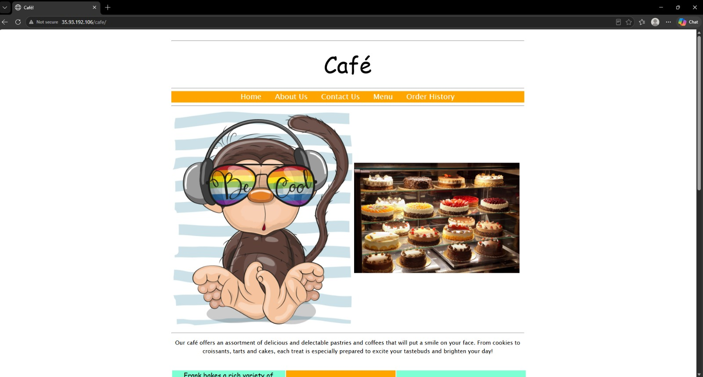

### 5. Detection of Unauthorized Security Group Rule

Inspection of the instance Security Group revealing a rogue inbound rule opening TCP port `22` (SSH) to all IPv4 addresses (`0.0.0.0/0`).

Identifying unauthorized network perimeter changes highlights how the attacker bypassed the `/32` IP restriction to establish direct SSH access to the EC2 host.

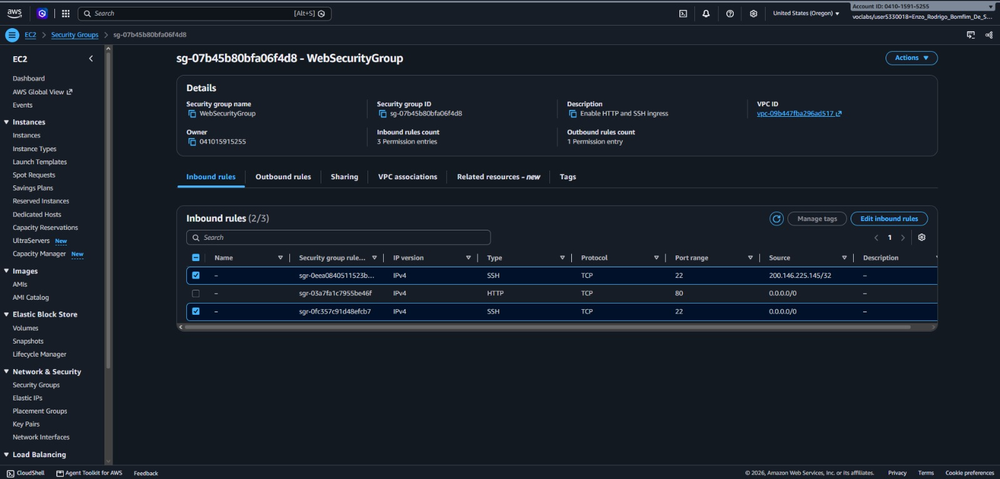

### 6. Amazon Athena Table Setup and CloudTrail SQL Queries

Configuration of the external table `cloudtrail_logs_monitoring####` in Amazon Athena and execution of SQL queries to parse JSON log records directly from Amazon S3.

Amazon Athena enables rapid relational querying across complex CloudTrail structures (`useridentity`, `eventtime`, `eventsource`, `eventname`, `requestparameters`) without manual file extraction.

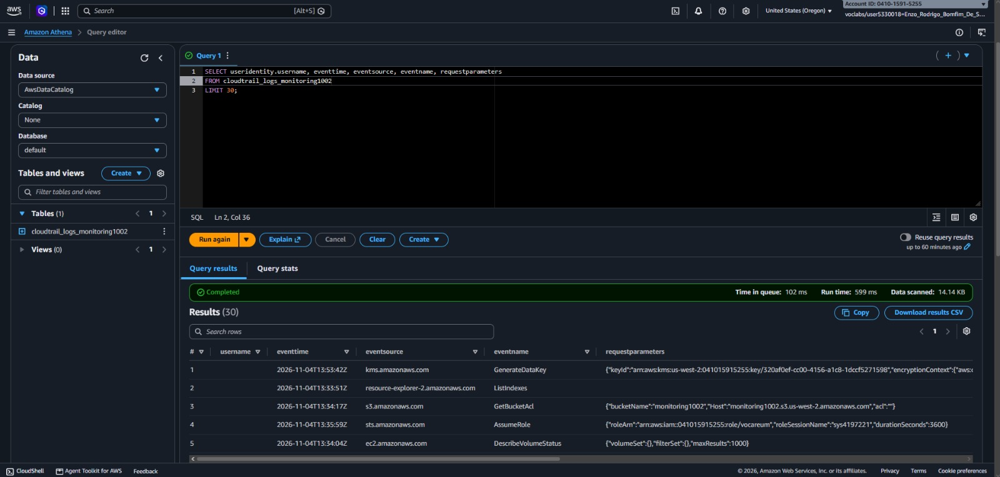

### 7. Forensic Identification of the Compromised IAM User

Execution of targeted Athena SQL filters isolating `ec2.amazonaws.com` security group events, pinpointing the `chaos` IAM user as the actor who opened port `22` to `0.0.0.0/0`.

Correlating `useridentity.userName`, `sourceIPAddress`, and `requestparameters` provides definitive attribution for incident response and credential revocation.

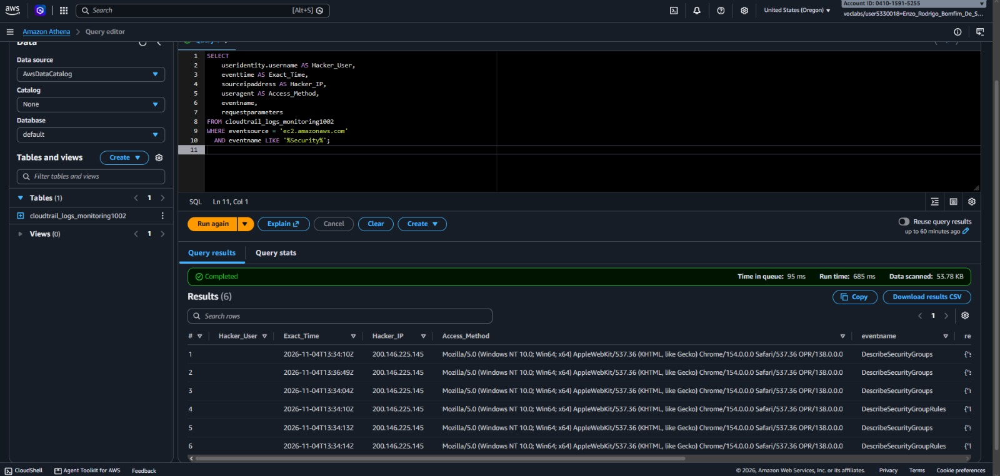

### 8. Linux Authentication Audit and Rogue Session Discovery

Execution of `sudo aureport --auth` and `who` on the EC2 instance revealing an active SSH login session belonging to the unauthorized OS user `chaos-user`.

Auditing host-level authentication logs confirms lateral movement from the AWS control plane into the guest operating system and identifies active attacker processes.

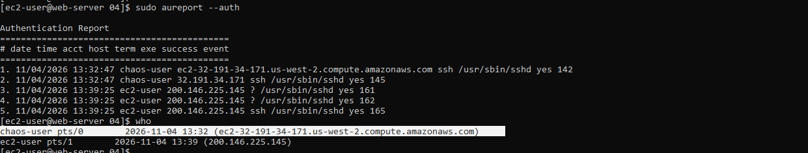

### 9. Termination of Rogue Process and OS User Removal

Termination of the active `chaos-user` shell process using `sudo kill -9` followed by complete account removal with `sudo userdel -r chaos-user` and verification of `/etc/passwd`.

Forcibly ending active intruder sessions and removing unauthorized local accounts prevents persistence inside the Linux environment.

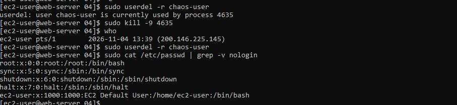

### 10. OpenSSH Hardening and Security Group Remediation

Modification of `/etc/ssh/sshd_config` to enforce `PasswordAuthentication no`, restart of the `sshd` service, and removal of the `0.0.0.0/0` SSH rule from the EC2 Security Group.

Disabling password-based SSH authentication ensures that only holders of valid cryptographic key pairs from authorized IP ranges can authenticate to the server.

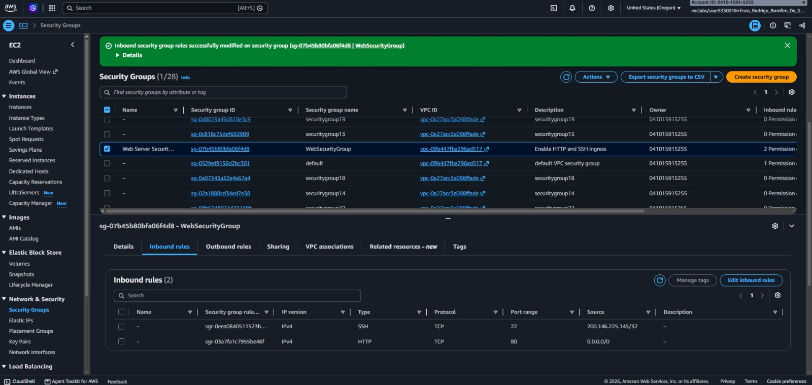

### 11. Web Application Asset Restoration and Verification

Restoration of the original `Coffee-and-Pastries.jpg` file from backup in `/var/www/html/cafe/images/` and browser verification of the recovered web page.

Restoring verified application assets after locking down network and OS access returns the service to normal production operation safely.

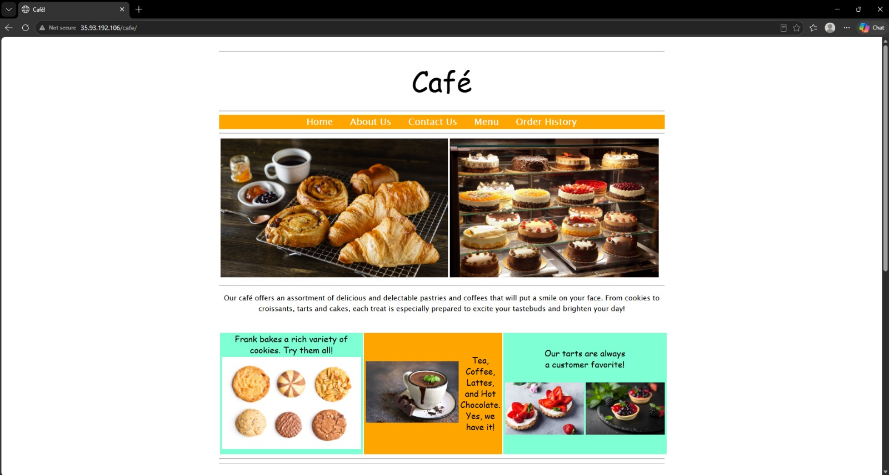

### 12. Compromised IAM User Deletion

Permanent deletion of the compromised `chaos` IAM user in the AWS Identity and Access Management console.

Revoking and removing compromised IAM identities closes the control-plane attack vector and prevents further unauthorized API calls in the AWS account.

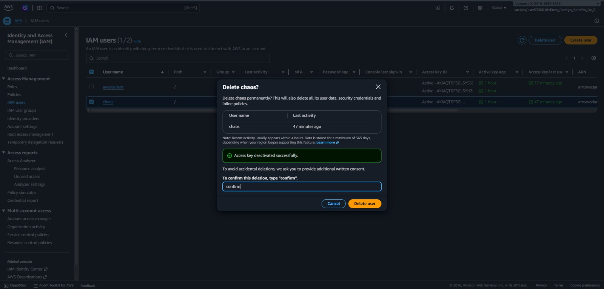
