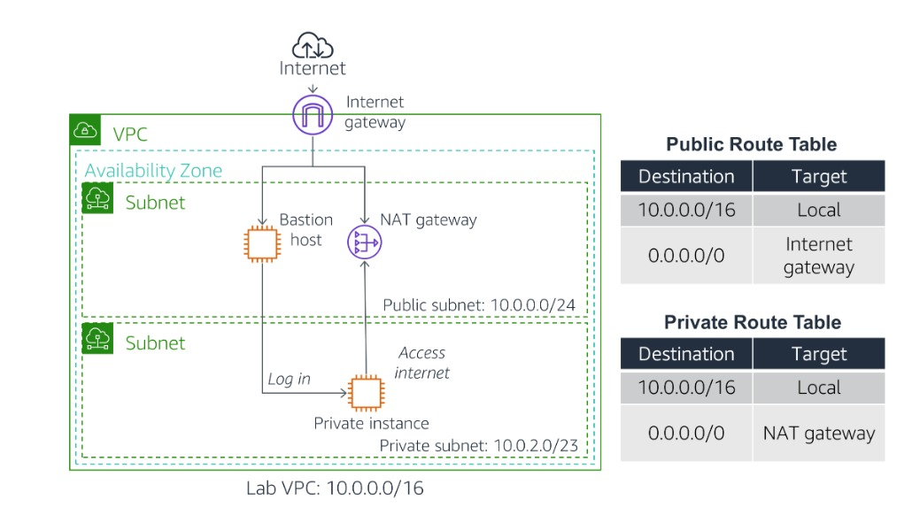
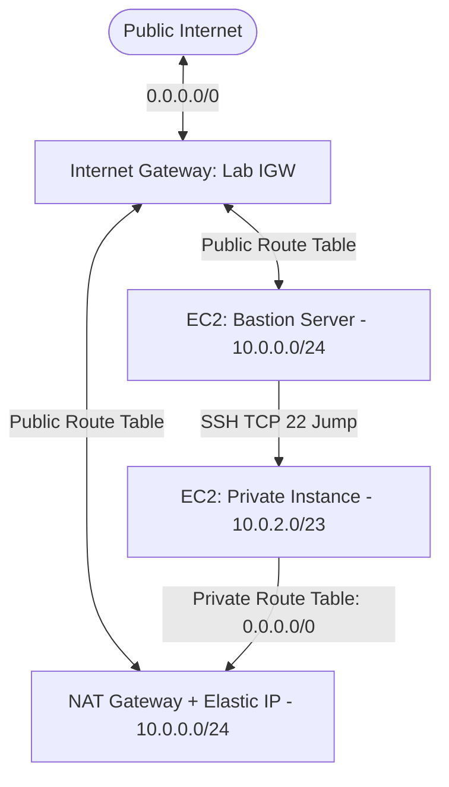

# 🌐 AWS Custom VPC Architecture with Bastion Host & NAT Gateway


A foundational cloud networking project on AWS demonstrating how to design and provision a logically isolated **Amazon Virtual Private Cloud (VPC)** from scratch. The architecture implements public and private subnet segmentation, custom **Route Tables**, an **Internet Gateway (IGW)**, an Elastic IP-backed **NAT Gateway**, a **Bastion Host (Jump Box)** in the public tier, and an isolated **Amazon EC2** instance in the private tier with verified outbound internet connectivity.

---

## 📌 Project Overview & Objectives

This hands-on project builds a production-style public/private network topology inside a custom IPv4 CIDR block (`10.0.0.0/16`). It enforces network isolation for backend compute resources while still allowing controlled administrative SSH access via a Bastion Host and outbound-only internet access via a NAT Gateway.

**Primary Objectives:**
* Provision a custom **Amazon VPC (`Lab VPC`)** with a `10.0.0.0/16` IPv4 CIDR block and DNS hostnames enabled.
* Segment the network into a **Public Subnet (`10.0.0.0/24`)** with automatic public IPv4 assignment and a larger **Private Subnet (`10.0.2.0/23`)** for internal workloads.
* Configure an **Internet Gateway (`Lab IGW`)** and a **NAT Gateway (`Lab NAT gateway`)** with an Elastic IP.
* Configure custom **Public and Private Route Tables** to control local (`10.0.0.0/16`) and internet-bound (`0.0.0.0/0`) traffic flows.
* Deploy a **Bastion Server** in the public subnet and use it as an SSH jump box to access a **Private EC2 Instance** in the private subnet and verify outbound internet reachability.

---

## ✨ Key Features

* **Custom IPv4 CIDR Segmentation:** Allocates a `/24` block (`256` total IPs) for public-facing infrastructure and a `/23` block (`512` total IPs across `10.0.2.x` and `10.0.3.x`) for private workloads.
* **Tiered Routing Isolation:** Separates public routing (via `Lab IGW`) from private outbound routing (via `Lab NAT gateway`).
* **Bastion Host Jump Box Pattern:** Restricts direct internet access to private compute instances, requiring operators to authenticate first to the public `Bastion Server` before hopping into the private subnet over SSH.
* **Stateful Security Group Chaining:** Limits inbound SSH (`TCP 22`) on the `Private Instance SG` exclusively to traffic originating within the VPC CIDR (`10.0.0.0/16`).
* **Automated Instance Bootstrapping:** Uses EC2 **User Data** (`bash`) to configure SSH authentication on the private EC2 instance during initial boot.

---

## 🏗️ Network Architecture & Traffic Workflow



```text
                        [ 🌍 Public Internet ]
                                  │
                                  ▼
                     [ 🌐 Internet Gateway: Lab IGW ]
                                  │
+---------------------------------│---------------------------------------+
| Lab VPC (10.0.0.0/16)           ▼                                       |
|  +-------------------------------------------------------------------+  |
|  | Public Subnet (10.0.0.0/24)                                       |  |
|  | Associated Route Table: Public Route Table (0.0.0.0/0 -> Lab IGW) |  |
|  |                                                                   |  |
|  |   [ 🛡️ Bastion Server (EC2 t3.micro) ]   [ 🔄 Lab NAT Gateway ]    |  |
|  |     SG: Bastion Security Group (SSH)       (Elastic IP Attached)  |  |
|  +------------------│-----------------------------------▲------------+  |
|                     │                                   │               |
|         1. SSH Jump │ (TCP 22 from 10.0.0.0/16)         │ 2. Outbound   |
|                     ▼                                   │    Traffic    |
|  +------------------------------------------------------│------------+  |
|  | Private Subnet (10.0.2.0/23)                         │            |  |
|  | Associated Route Table: Private Route Table (0.0.0.0/0 -> NAT GW) |  |
|  |                                                                   |  |
|  |   [ 🔒 Private Instance (EC2 t3.micro) ] ────────────┘            |  |
|  |     SG: Private Instance SG (Allows SSH from 10.0.0.0/16 only)    |  |
|  +-------------------------------------------------------------------+  |
+-------------------------------------------------------------------------+
```



---

## 🛠️ AWS Services & Network Components

| Component / Service | Specification / Configuration | Role in Architecture |
| :--- | :--- | :--- |
| **Amazon VPC (`Lab VPC`)** | CIDR `10.0.0.0/16`, DNS hostnames enabled | Provides the logically isolated virtual network in the AWS Cloud. |
| **Public Subnet** | CIDR `10.0.0.0/24`, Auto-assign Public IPv4 | Hosts internet-facing components (`Bastion Server` and `Lab NAT gateway`). |
| **Private Subnet** | CIDR `10.0.2.0/23` (`10.0.2.x` – `10.0.3.x`) | Isolates backend EC2 instances from direct inbound internet traffic. |
| **Internet Gateway (`Lab IGW`)** | Attached to `Lab VPC` | Enables bidirectional internet connectivity for resources in the public subnet. |
| **NAT Gateway (`Lab NAT gateway`)** | Deployed in `Public Subnet` with Elastic IP | Enables private subnet instances to initiate outbound internet connections while blocking inbound external connections. |
| **Public Route Table** | `10.0.0.0/16` → `local`<br>`0.0.0.0/0` → `Lab IGW` | Routes internet-bound traffic from `Public Subnet` directly to the Internet Gateway. |
| **Private Route Table** | `10.0.0.0/16` → `local`<br>`0.0.0.0/0` → `Lab NAT gateway` | Routes outbound internet traffic from `Private Subnet` through the NAT Gateway. |
| **Amazon EC2 (`Bastion Server`)** | Amazon Linux 2023, `t3.micro`, `Bastion Security Group` | Acts as the secure jump box in the public subnet accessed via EC2 Instance Connect. |
| **Amazon EC2 (`Private Instance`)** | Amazon Linux 2023, `t3.micro`, `Private Instance SG` | Runs in the isolated private subnet; accessible only via internal SSH from the VPC. |

---

## ⚙️ Step-by-Step Implementation

### 1. VPC Creation (`Lab VPC`)
* Provisioned a custom VPC named `Lab VPC` using manual IPv4 CIDR input `10.0.0.0/16` and default tenancy.
* Enabled **DNS hostnames** (`Enable DNS hostnames`) so EC2 instances launched in the VPC automatically receive public IPv4 DNS hostnames where applicable.

### 2. Public & Private Subnet Provisioning
* **Public Subnet (`10.0.0.0/24`):** Created in the first Availability Zone and enabled **Auto-assign public IPv4 address**.
* **Private Subnet (`10.0.2.0/23`):** Created in the same Availability Zone with twice the address space (`512` IPv4 addresses) to host private backend workloads without public IPv4 addresses.

### 3. Internet Gateway & Route Table Configuration
* Created the Internet Gateway `Lab IGW` and attached it to `Lab VPC`.
* Renamed the default VPC route table to `Private Route Table` (initially containing only the local `10.0.0.0/16` route).
* Created `Public Route Table` in `Lab VPC`, added a default route (`0.0.0.0/0` → `Lab IGW`), and explicitly associated it with `Public Subnet`.

### 4. Bastion Host Deployment in the Public Subnet
* Launched an Amazon EC2 instance named `Bastion Server` (`Amazon Linux 2023 AMI`, `t3.micro`) inside `Public Subnet` with public IPv4 auto-assignment enabled.
* Configured `Bastion Security Group` (`Allow SSH`) permitting inbound `SSH (TCP 22)` traffic.

### 5. NAT Gateway Deployment & Private Routing
* Provisioned `Lab NAT gateway` inside `Public Subnet` with an allocated **Elastic IP**.
* Updated `Private Route Table` by adding a default outbound route (`0.0.0.0/0` → `Lab NAT gateway`).

### 6. Challenge Implementation — Private EC2 Instance & Bootstrapping
Launched a second EC2 instance named `Private Instance` (`Amazon Linux 2023 AMI`, `t3.micro`) inside `Private Subnet` with the following security and bootstrap settings:
* **Security Group (`Private Instance SG`):** Configured description `Allow SSH from Bastion` with an inbound rule allowing `SSH (TCP 22)` solely from the VPC CIDR `10.0.0.0/16`.
* **EC2 User Data Script:** Configured password authentication at launch to enable SSH jump testing from the Bastion Host:

```bash
#!/bin/bash
# Turn on password authentication for lab challenge
echo 'lab-password' | passwd ec2-user --stdin
sed -i 's|[#]*PasswordAuthentication no|PasswordAuthentication yes|g' /etc/ssh/sshd_config
systemctl restart sshd.service
```

---

## 🧪 Testing & Validation

### 1. SSH Hop from Bastion Host to Private Instance
1. Connected to `Bastion Server` in `Public Subnet` using **EC2 Instance Connect**.
2. Copied the private IPv4 address (`10.0.2.x` / `10.0.3.x`) of `Private Instance` and established an internal SSH session from the Bastion terminal:
   ```bash
   ssh <PRIVATE-IP>
   ```
3. Authenticated as `ec2-user` using the configured lab password, confirming internal VPC routing (`10.0.0.0/16`) and `Private Instance SG` rules worked as expected.

### 2. Outbound Internet Connectivity Test via NAT Gateway
From inside the `Private Instance` SSH session, tested external internet reachability and DNS resolution using `ping`:

```bash
ping -c 3 amazon.com
```

**Expected & Verified Output:**
```text
PING amazon.com (176.32.98.166) 56(84) bytes of data.
64 bytes from 176.32.98.166 (176.32.98.166): icmp_seq=1 ttl=222 time=79.2 ms
64 bytes from 176.32.98.166 (176.32.98.166): icmp_seq=2 ttl=222 time=79.2 ms
64 bytes from 176.32.98.166 (176.32.98.166): icmp_seq=3 ttl=222 time=79.0 ms
```

Zero packet loss confirmed that `Private Instance` successfully routed outbound ICMP traffic through `Private Route Table` → `Lab NAT gateway` → `Lab IGW` to the internet and received return traffic while remaining unreachable directly from outside the VPC.

---

## 📸 Implementation Screenshots

Complete visual evidence of the VPC provisioning, routing configuration, Bastion deployment, and NAT Gateway validation is available in the [**screenshots/**](./screenshots/) directory:

1. [VPC Creation (`Lab VPC`)](./screenshots/SCREENSHOTS.md#1-vpc-creation)
2. [Public Subnet Creation](./screenshots/SCREENSHOTS.md#2-public-subnet-creation)
3. [Internet Gateway Creation and Attachment](./screenshots/SCREENSHOTS.md#3-internet-gateway-creation-and-attachment)
4. [Route Tables Configuration](./screenshots/SCREENSHOTS.md#4-route-tables-configuration)
5. [Launching the Bastion Host in the Public Subnet](./screenshots/SCREENSHOTS.md#5-launching-the-bastion-host-in-the-public-subnet)
6. [NAT Gateway Creation and Private Route Update](./screenshots/SCREENSHOTS.md#6-nat-gateway-creation-and-private-route-update)
7. [Challenge: Private Instance Outbound Internet Test via NAT Gateway](./screenshots/SCREENSHOTS.md#7-challenge--private-instance-outbound-internet-test-via-nat-gateway)
8. [VPC Architecture Diagram](./screenshots/SCREENSHOTS.md#8-vpc-architecture-diagram)

---

## 🔒 Security Considerations & Potential Improvements

### Implemented Practices
* **Network Tier Isolation:** Backend compute (`Private Instance`) is placed in `Private Subnet` (`10.0.2.0/23`) without a public IPv4 address.
* **Internal-Only SSH Rule:** `Private Instance SG` restricts inbound SSH (`TCP 22`) to the internal VPC CIDR (`10.0.0.0/16`) rather than `0.0.0.0/0`.
* **Unidirectional NAT Egress:** `Lab NAT gateway` allows private instances to fetch updates and reach external endpoints without exposing them to inbound internet connections.

### Potential Future Enhancements (Not Currently Implemented)
* **AWS Systems Manager Session Manager:** Replace the public Bastion Host and password-based SSH authentication (`PasswordAuthentication yes` used for lab simplicity) with **SSM Session Manager** or SSH key pairs / EC2 Instance Connect Endpoint to eliminate open inbound port `22`.
* **Restricted Bastion Ingress:** Narrow `Bastion Security Group` inbound SSH source from `0.0.0.0/0` (`Anywhere`) to specific trusted corporate/administrator `/32` IP addresses.
* **Multi-AZ High Availability:** Provision a second Public Subnet (with a second NAT Gateway) and a second Private Subnet in another Availability Zone to eliminate single points of failure.

---

## 🎯 Key Technical Skills Demonstrated

* **VPC Design & CIDR Planning:** Designing `/16`, `/24`, and `/23` IPv4 address blocks and configuring DNS resolution attributes.
* **Cloud Routing & Gateways:** Configuring Route Tables, Subnet Associations, Internet Gateways, Elastic IPs, and NAT Gateways.
* **Bastion Host & Perimeter Security:** Deploying a jump-box architecture and restricting east-west traffic using Security Groups.
* **Linux Networking & Bootstrapping:** Writing EC2 User Data bash scripts, performing multi-hop SSH sessions, and validating network paths with `ping`.
