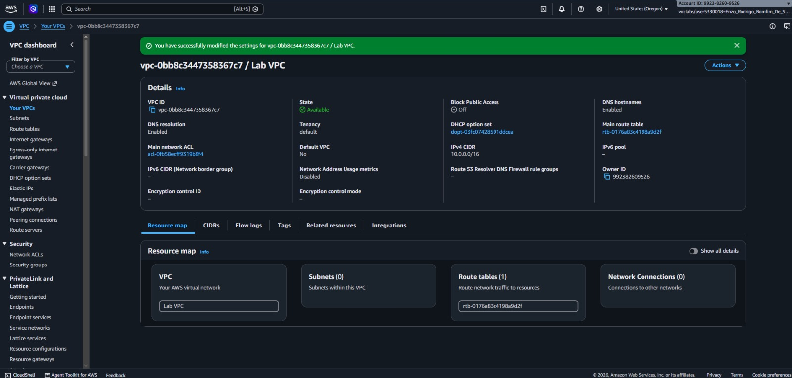
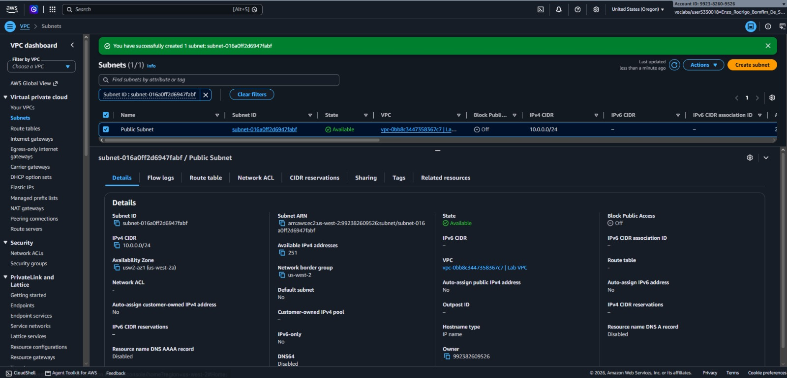
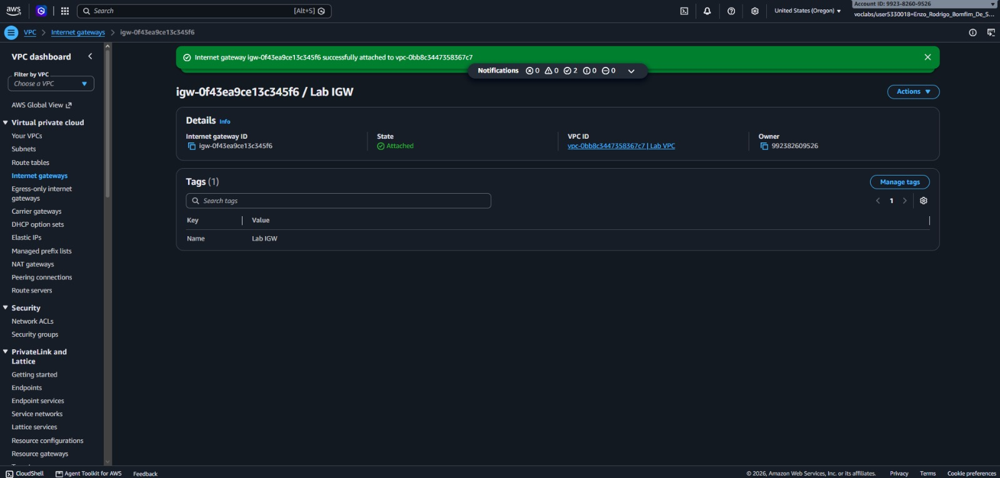
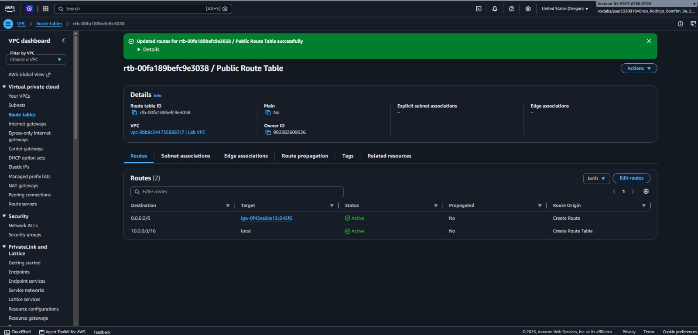
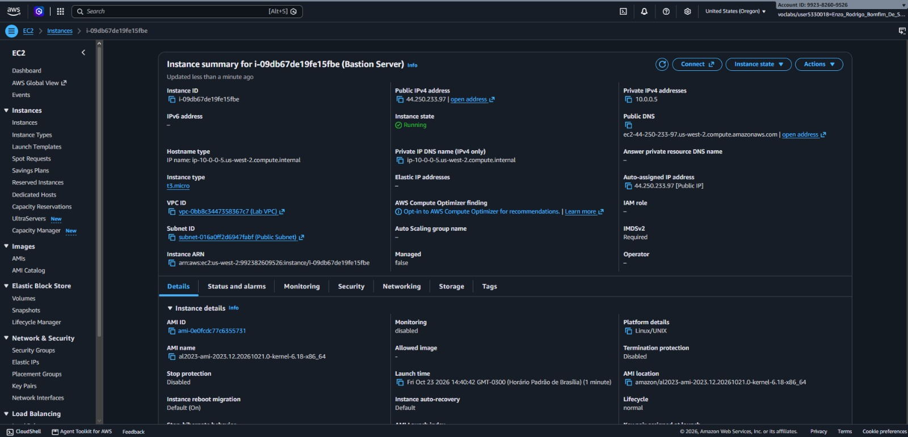
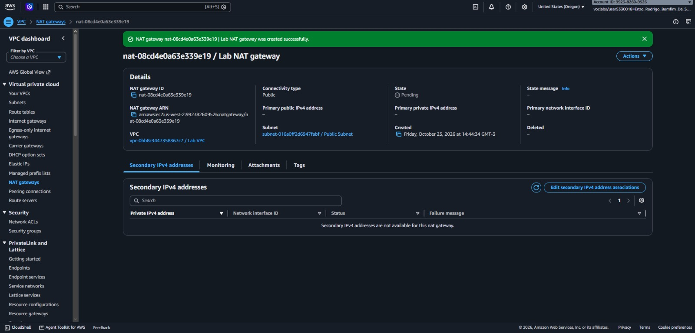
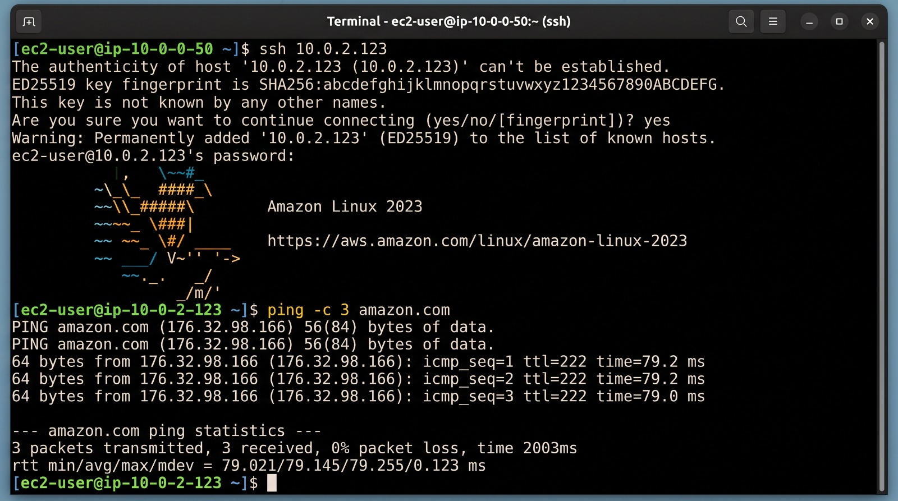

# 📸 Project Implementation & Validation Screenshots

This document provides step-by-step visual evidence of the provisioning, routing configuration, Bastion Host deployment, and NAT Gateway connectivity validation for the **AWS Custom VPC Architecture** project.

---

## 1. VPC Creation

Provisioning of `Lab VPC` with the `10.0.0.0/16` IPv4 CIDR block and DNS hostnames enabled.

---

## 2. Public Subnet Creation

Creation of `Public Subnet` (`10.0.0.0/24`) inside `Lab VPC` with automatic public IPv4 address assignment enabled.

---

## 3. Internet Gateway Creation and Attachment

Creation of the `Lab IGW` Internet Gateway and attachment to `Lab VPC` to enable external internet communication for the public tier.

---

## 4. Route Tables Configuration

Configuration of `Public Route Table` (`0.0.0.0/0` routed to `Lab IGW`, associated with `Public Subnet`) and `Private Route Table` for internal VPC traffic control.

---

## 5. Launching the Bastion Host in the Public Subnet

Deployment of the `Bastion Server` Amazon EC2 instance (`Amazon Linux 2023`, `t3.micro`) in `Public Subnet` to serve as a secure jump box for accessing resources in `Private Subnet`.

---

## 6. NAT Gateway Creation and Private Route Update

Provisioning of `Lab NAT gateway` with an Elastic IP in `Public Subnet` and updating `Private Route Table` (`0.0.0.0/0` → `Lab NAT gateway`) to provide outbound internet access for private resources.

---

## 7. Challenge — Private Instance Outbound Internet Test via NAT Gateway

Verification of multi-hop SSH access from `Bastion Server` to `Private Instance` (`10.0.2.0/23`) and successful outbound internet connectivity (`ping -c 3 amazon.com`) routed through `Lab NAT gateway`.

---

## 8. VPC Architecture Diagram

Complete architectural topology of `Lab VPC` illustrating the public and private subnets, route tables, Internet Gateway, NAT Gateway, Bastion Host, and Private EC2 Instance.

