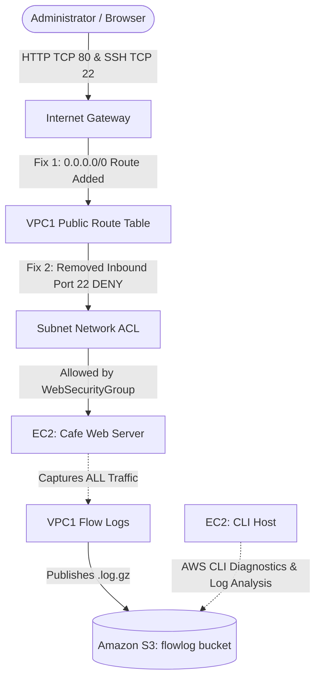

# 🔍 AWS VPC Network Troubleshooting & Flow Logs Analysis


A practical cloud network diagnostics and incident investigation project on AWS. This project demonstrates how to capture IP traffic telemetry using **Amazon VPC Flow Logs** published to **Amazon S3**, diagnose and remediate multi-layer network connectivity outages (HTTP and SSH) exclusively via the **AWS CLI**, and audit rejected connection attempts (`REJECT`) using Linux CLI utilities (`grep`, `gunzip`, `date`, `nmap`).

---

## 📌 Project Overview & Objectives

In this scenario, an **Amazon EC2** web server (`Café Web Server` / `web-server`) deployed in the public subnet of `VPC1` (`10.1.0.0/16`) was unreachable over both HTTP (`TCP 80`) and SSH (`TCP 22`). Using a dedicated administration instance (`CLI Host`), VPC Flow Logs were enabled prior to troubleshooting so that all accepted and rejected network packets across `VPC1` Elastic Network Interfaces (ENIs) were recorded and later analyzed in **Amazon S3**.

**Primary Objectives:**
* Provision an **Amazon S3** bucket and configure **Amazon VPC Flow Logs** via the **AWS CLI** to capture all IP traffic (`ALL`) in `VPC1`.
* Investigate and resolve an internet routing outage preventing HTTP access to the public web server.
* Investigate and resolve a subnet-level firewall block preventing SSH connectivity (`EC2 Instance Connect`) to the web server.
* Download, extract, and parse compressed **VPC Flow Log** archives (`.log.gz`) to correlate failed SSH attempts (`REJECT`) with source IPs, target ENIs, and Unix epoch timestamps.

---

## ✨ Key Features

* **Programmatic Network Diagnostics:** Performs full discovery and remediation of VPC Route Tables, Internet Gateways, Security Groups, Network ACLs, and ENIs using **AWS CLI** queries (`--query` and `--filters`).
* **Centralized Traffic Telemetry:** Captures VPC-wide network flows (`ACCEPT` and `REJECT`) directly into structured **Amazon S3** log partitions (`AWSLogs/<AccountID>/vpcflowlogs/us-west-2/yyyy/mm/dd/`).
* **Multi-Layer Root Cause Analysis:** Diagnoses network failures across both Layer 3 routing (**Route Tables**) and Layer 4 stateless subnet filtering (**Network ACLs**).
* **Forensic Log Auditing:** Filters raw flow log records by port (`22`), action (`REJECT`), and source IP using `grep`, and converts Unix epoch timestamps (`date -d @...`) to verify exact incident timelines.

---

## 🏗️ Architecture & Troubleshooting Workflow

```text
+-----------------------------------------------------------------------------------+
| AWS Cloud (Region: us-west-2)                                                     |
|                                                                                   |
|  [ 🖥️ CLI Host (EC2) ] ──(1. Creates S3 Bucket & VPC Flow Logs via AWS CLI)──┐    |
|            │                                                                 ▼    |
|            │ (2. Diagnoses & fixes Route Table + Network ACL)     [ 📦 Amazon S3 ]|
|            ▼                                                       (flowlog######)|
|  +-------------------------------------------------------------------+       ▲    |
|  | VPC1 (10.1.0.0/16)                                                |       │    |
|  |                                                                   | (Publishes |
|  |   [ 🌐 Internet Gateway ]                                         |  Flow Logs)|
|  |              ▲                                                    |       │    |
|  |              │ Fix #1: Added Route 0.0.0.0/0 -> igw-xxxx          |       │    |
|  |   [ 🗺️ Public Route Table ] (Initially only 10.1.0.0/16 -> local) |       │    |
|  |              │                                                    |       │    |
|  |   +----------│------------------------------------------------+   |       │    |
|  |   | Public Subnet                                             |   |       │    |
|  |   |   [ 🛡️ Network ACL ]                                      |   |       │    |
|  |   |     └── Fix #2: Removed Inbound DENY Rule on TCP Port 22  |   |       │    |
|  |   |                                                           |   |       │    |
|  |   |   [ 🌐 Café Web Server (EC2: web-server) ] ───────────────┼───┼───────┘    |
|  |   |     └── SG: WebSecurityGroup (Allows TCP 80 & TCP 22)     |   |            |
|  |   +-----------------------------------------------------------+   |            |
|  +-------------------------------------------------------------------+            |
+-----------------------------------------------------------------------------------+
```



---

## 🛠️ AWS Services & CLI Tools Used

| Service / Tool | Role in Project |
| :--- | :--- |
| **Amazon VPC** | Hosts `VPC1` (`10.1.0.0/16`), public subnets, Route Tables, Internet Gateway, Security Groups, and Network ACLs. |
| **Amazon VPC Flow Logs** | Captures IP traffic metadata (`ACCEPT` / `REJECT`) across network interfaces in `VPC1`. |
| **Amazon S3** | Provides durable storage (`flowlog######`) for compressed VPC Flow Log files (`.log.gz`). |
| **Amazon EC2** | Runs the target `Café Web Server` (`web-server`) and the `CLI Host` administration instance. |
| **AWS CLI** | Used to provision S3/Flow Logs, inspect VPC configurations, and remediate routing and NACL misconfigurations. |
| **Linux Utilities (`nmap`, `grep`, `gunzip`, `date`)** | Used to scan open ports, decompress S3 flow log archives, filter `REJECT` events, and decode Unix timestamps. |

---

## ⚙️ Step-by-Step Implementation & Troubleshooting

### 1. Configuring the AWS CLI & Enabling VPC Flow Logs
Connected to `CLI Host` via **EC2 Instance Connect**, configured the AWS CLI for `us-west-2`, created a dedicated S3 bucket, and enabled VPC Flow Logs on `VPC1`:

```bash
# 1. Configure AWS CLI credentials and default region (us-west-2)
aws configure

# 2. Create the Amazon S3 bucket for storing VPC Flow Logs
aws s3api create-bucket \
  --bucket flowlog###### \
  --region 'us-west-2' \
  --create-bucket-configuration LocationConstraint='us-west-2'

# 3. Retrieve the VPC ID and CIDR block of VPC1
aws ec2 describe-vpcs \
  --query 'Vpcs[*].[VpcId,Tags[?Key==`Name`].Value,CidrBlock]' \
  --filters "Name=tag:Name,Values='VPC1'"

# 4. Create a VPC Flow Log capturing ALL traffic in VPC1 and publishing to S3
aws ec2 create-flow-logs \
  --resource-type VPC \
  --resource-ids <vpc-id> \
  --traffic-type ALL \
  --log-destination-type s3 \
  --log-destination arn:aws:s3:::<flowlog######>

# 5. Confirm FlowLogStatus is ACTIVE
aws ec2 describe-flow-logs
```

---

### 2. Troubleshooting Challenge #1 — Web Server HTTP Unreachable

* **Symptom:** Navigating to `http://<WebServerIP>` timed out in the browser, and running `nmap <WebServerIP>` showed no reachable ports despite the EC2 instance being in the `running` state.
* **Investigation via AWS CLI:**
  ```bash
  # Inspect Web Server instance state, subnet, and security groups
  aws ec2 describe-instances \
    --filter "Name=ip-address,Values='<WebServerIP>'" \
    --query 'Reservations[*].Instances[*].[State,PrivateIpAddress,InstanceId,SecurityGroups,SubnetId,KeyName]'

  # Verify Security Group rules (confirmed HTTP 80 and SSH 22 were allowed)
  aws ec2 describe-security-groups --group-ids <WebServerSgId>

  # Inspect the Route Table associated with the VPC1 Public Subnet
  aws ec2 describe-route-tables \
    --filter "Name=association.subnet-id,Values='<VPC1PubSubnetID>'"
  ```
* **Root Cause #1:** The route table associated with the public subnet only contained the local route (`10.1.0.0/16 -> local`). It was missing a default route (`0.0.0.0/0`) pointing to the Internet Gateway.
* **Remediation:** Identified the Internet Gateway ID and added the missing default route:
  ```bash
  aws ec2 describe-internet-gateways

  aws ec2 create-route \
    --route-table-id <route-table-id> \
    --destination-cidr-block 0.0.0.0/0 \
    --gateway-id <igw-id>
  ```
* **Validation:** Refreshed `http://<WebServerIP>` in the browser and confirmed the page loaded `"Hello From Your Web Server!"`.

---

### 3. Troubleshooting Challenge #2 — SSH Connection Rejected

* **Symptom:** After restoring HTTP connectivity, attempting to connect to `Café Web Server` via **EC2 Instance Connect (SSH TCP 22)** still failed with a connection error.
* **Investigation via AWS CLI:** Inspected the **Network ACL (NACL)** associated with `<VPC1PublicSubnetID>`:
  ```bash
  aws ec2 describe-network-acls \
    --filter "Name=association.subnet-id,Values='<VPC1PublicSubnetID>'" \
    --query 'NetworkAcls[*].[NetworkAclId,Entries]'
  ```
* **Root Cause #2:** The JSON output revealed an explicit inbound rule (`"Egress": false`) with `"RuleAction": "deny"` blocking TCP port `22` (`"From": 22, "To": 22`) evaluated before the allow rule.
* **Remediation:** Deleted the offending inbound NACL entry via the AWS CLI:
  ```bash
  aws ec2 delete-network-acl-entry \
    --network-acl-id <network-acl-id> \
    --ingress \
    --rule-number <deny-rule-number>
  ```
* **Validation:** Connected to `Café Web Server` via **EC2 Instance Connect** and ran `hostname`, confirming access to `web-server` (`[ec2-user@web-server ~]$`).

---

## 📊 Task 4 — VPC Flow Logs Forensics & Timestamp Analysis

### 1. Downloading & Extracting S3 Flow Log Archives
```bash
mkdir flowlogs && cd flowlogs
aws s3 ls
aws s3 cp s3://<flowlog######>/ . --recursive
cd AWSLogs/<AccountID>/vpcflowlogs/us-west-2/2026/10/23/
gunzip *.gz
ls
```

### 2. Filtering Rejected SSH Traffic (`REJECT` on Port `22`)
```bash
# Inspect Flow Log column headers
head <log-file-name>

# Search and count all REJECT events across extracted log files
grep -rn REJECT .
grep -rn REJECT . | wc -l

# Narrow down to rejected SSH (port 22) attempts from the client IP
grep -rn 22 . | grep REJECT
grep -rn 22 . | grep REJECT | grep <client-ip-address>

# Correlate the Elastic Network Interface (ENI) ID in the logs with the Web Server Public IP
aws ec2 describe-network-interfaces \
  --filters "Name=association.public-ip,Values='<WebServerIP>'" \
  --query 'NetworkInterfaces[*].[NetworkInterfaceId,Association.PublicIp]'
```

### 3. Decoding Unix Timestamps from Captured `REJECT` Events
Converted the Unix epoch timestamp (`1792793692`) from the captured SSH `REJECT` log record into human-readable UTC format and compared it against the current system clock on `web-server`:

```bash
[ec2-user@web-server 23]$ date -d @1792793692
Fri Oct 23 22:14:52 UTC 2026

[ec2-user@web-server 23]$ date
Fri Oct 23 23:17:39 UTC 2026
```

This confirmed that the rejected SSH packets recorded in the VPC Flow Logs matched the exact time window of the initial connection tests prior to removing the NACL deny rule.

---

## 📸 Implementation Screenshots

Complete visual evidence of the S3 and Flow Log provisioning, root cause identification, remediation, and log analysis is available in the [**screenshots/**](./screenshots/) directory:

1. [Creating the Amazon S3 Bucket for Flow Logs](./screenshots/SCREENSHOTS.md#1-creating-the-amazon-s3-bucket-for-flow-logs)
2. [Creating the VPC1 Flow Log Pointing to Amazon S3](./screenshots/SCREENSHOTS.md#2-creating-the-vpc1-flow-log-pointing-to-amazon-s3)
3. [Issue #1 Root Cause: Missing Internet Gateway Route (`0.0.0.0/0`)](./screenshots/SCREENSHOTS.md#3-issue-1-root-cause--missing-internet-gateway-route)
4. [Fix #1 Validated: Web Server Accessible via Public IP](./screenshots/SCREENSHOTS.md#4-fix-1-validated--web-server-accessible-via-public-ip)
5. [Issue #2 Root Cause: Network ACL Inbound Deny Rule on Port 22](./screenshots/SCREENSHOTS.md#5-issue-2-root-cause--network-acl-inbound-deny-rule-on-port-22)
6. [Fix #2 Validated: SSH Connection Restored to Café Web Server](./screenshots/SCREENSHOTS.md#6-fix-2-validated--ssh-connection-restored-to-caf-web-server)
7. [Downloading and Extracting Compressed VPC Flow Logs](./screenshots/SCREENSHOTS.md#7-downloading-and-extracting-compressed-vpc-flow-logs)
8. [Flow Logs `REJECT` Analysis and Unix Timestamp Conversion](./screenshots/SCREENSHOTS.md#8-flow-logs-reject-analysis-and-unix-timestamp-conversion)

---

## 🔒 Security Considerations & Potential Improvements

### Implemented Practices
* **Full Traffic Visibility:** Enabled VPC Flow Logs at the VPC level (`ALL` traffic) to ensure both permitted and denied packets are auditable in Amazon S3.
* **Layered Firewall Verification:** Audited both stateful **Security Groups** and stateless **Network ACLs** to restore intended SSH and HTTP access without opening unnecessary ports.

### Potential Future Enhancements (Not Currently Implemented)
* **SQL Analytics with Amazon Athena:** Query VPC Flow Logs directly in Amazon S3 using **Amazon Athena** and **Amazon QuickSight** dashboards instead of manual `grep` searches for large-scale log analysis.
* **Automated Alerting with CloudWatch Metrics & Alarms:** Publish critical `REJECT` anomalies to Amazon CloudWatch Logs to trigger real-time security alerts.
* **S3 Lifecycle Policies:** Configure S3 Intelligent-Tiering or Glacier lifecycle rules on the `flowlog######` bucket to optimize long-term log retention costs.

---

## 🎯 Key Technical Skills Demonstrated

* **VPC Troubleshooting & Diagnostics:** Isolating routing vs. firewall misconfigurations across Route Tables, Internet Gateways, Security Groups, and Network ACLs.
* **AWS CLI Filtering & JMESPath Queries:** Extracting targeted infrastructure attributes using `--filter` and `--query` expressions.
* **VPC Flow Logs & Network Forensics:** Provisioning S3-backed flow logs, correlating ENI identifiers, filtering `REJECT` records, and decoding Unix timestamps.
* **Linux Systems Administration:** Using `nmap`, `gunzip`, `grep`, `wc`, `head`, and `date` via SSH/EC2 Instance Connect for operational troubleshooting.
