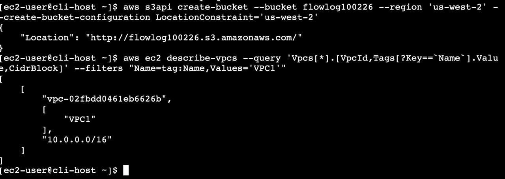
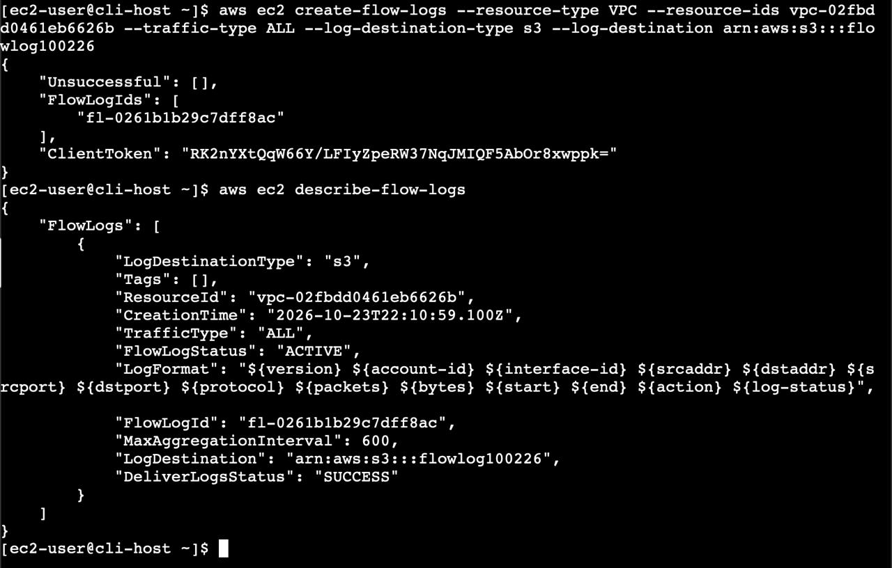
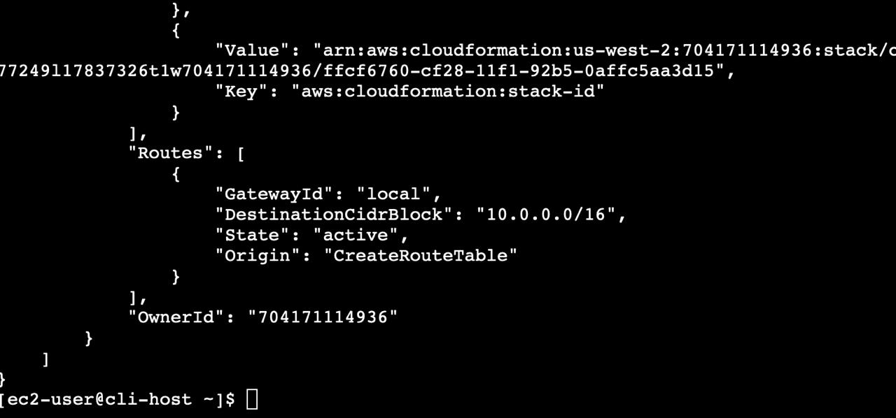
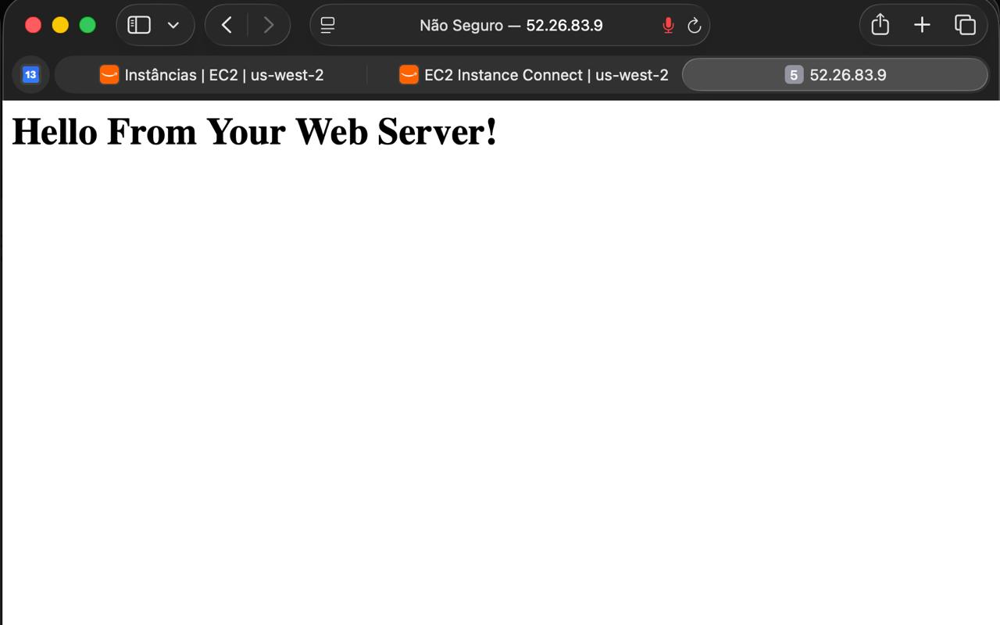
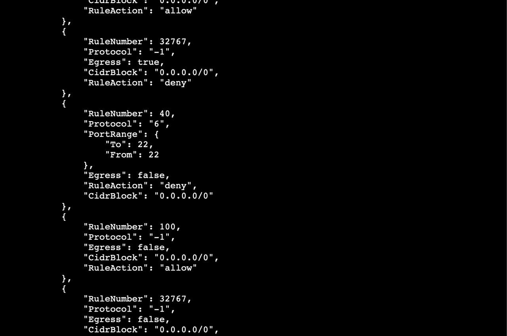
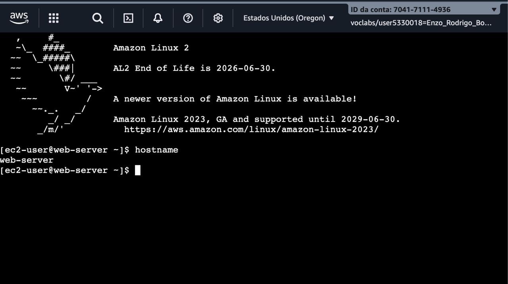
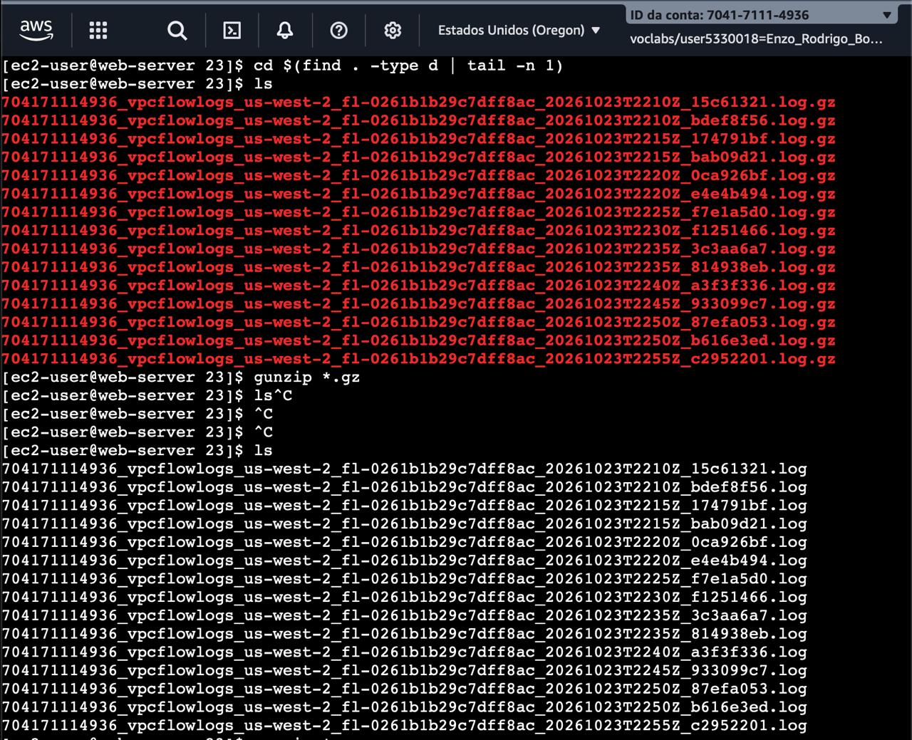
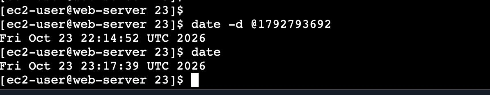

# 📸 Project Implementation & Validation Screenshots

This document provides step-by-step visual evidence of the VPC Flow Logs setup, network root cause diagnosis, CLI remediation, and forensic log analysis for the **AWS VPC Network Troubleshooting & Flow Logs Analysis** project.

---

## 1. Creating the Amazon S3 Bucket for Flow Logs

Provisioning of the Amazon S3 bucket (`flowlog######`) in `us-west-2` via the AWS CLI to store published VPC Flow Log archives.

---

## 2. Creating the VPC1 Flow Log Pointing to Amazon S3

Creation and verification of the VPC Flow Log on `VPC1` configured to capture `ALL` traffic and publish log files directly to the Amazon S3 bucket.

---

## 3. Issue #1 Root Cause — Missing Internet Gateway Route

Inspection of the `VPC1` public subnet Route Table revealing only the local route (`10.1.0.0/16 -> local`) and the absence of a default route (`0.0.0.0/0`) to the Internet Gateway.

---

## 4. Fix #1 Validated — Web Server Accessible via Public IP

Confirmation that the Café Web Server HTTP page loads properly in the browser via its public IPv4 address after adding the `0.0.0.0/0` route pointing to the Internet Gateway.

---

## 5. Issue #2 Root Cause — Network ACL Inbound Deny Rule on Port 22

Persistent SSH connection failure via EC2 Instance Connect and AWS CLI discovery of an explicit inbound Network ACL rule (`"Egress": false`, `"RuleAction": "deny"`) blocking TCP port `22` (`"From": 22, "To": 22`).

---

## 6. Fix #2 Validated — SSH Connection Restored to Café Web Server

Successful SSH session established to `Café Web Server` via EC2 Instance Connect after removing the blocking inbound Network ACL entry.

---

## 7. Downloading and Extracting Compressed VPC Flow Logs

Recursive download of the `.log.gz` VPC Flow Log files from Amazon S3 and decompression using `gunzip *.gz` for command-line inspection.

---

## 8. Flow Logs `REJECT` Analysis and Unix Timestamp Conversion

Terminal verification on `web-server` converting the captured `REJECT` event Unix epoch timestamp (`date -d @1792793692` → `Fri Oct 23 22:14:52 UTC 2026`) and comparing it with the current system time (`date` → `Fri Oct 23 23:17:39 UTC 2026`).

